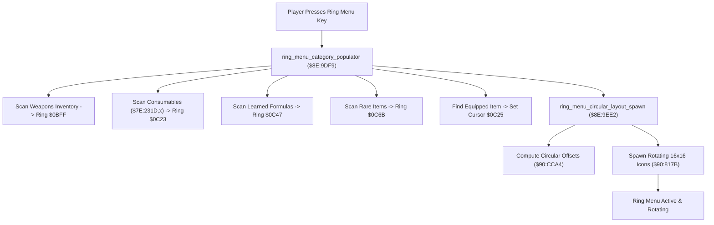

# Ring Menu Populator & Circular Layout Engine

- **ROM Locations**:
  - `ring_menu_category_populator`: `$8E:9DF9` – `$8E:9EBD`
  - `ring_menu_circular_layout_spawn`: `$8E:9EE2` – `$8E:9F25`
  - `ring_menu_definitions`: `$C4:5ABE` (master ring item ID table)
- **CPU State**: 16-bit A/X (`REP #$30`), Data Bank `$8E` / `$7E`
- **WRAM Core Addresses**:
  - `$7E:231D,x`: Consumable and weapon item counts in inventory.
  - `$7E:0BFF`: Weapons ring category item count.
  - `$7E:0C01`: Weapons ring category cursor index.
  - `$7E:0C23`: Consumables ring category item count.
  - `$7E:0C25`: Consumables ring category cursor index.
  - `$7E:0C27`..`$7E:0C45`: Consumables ring slot array (up to 16 entries).
  - `$7E:0C47`: Alchemy formulas ring category item count.
  - `$7E:0C49`: Alchemy formulas ring category cursor index.
  - `$7E:0C6B`: Rare / Key items ring category item count.
  - `$7E:0C6D`: Rare / Key items ring category cursor index.
  - `$7E:0DDB`: Boy ring sprite actor pointer.
  - `$7E:0DEB`: Dog ring sprite actor pointer.

---

## 1. Architectural Architecture & Ring Construction

When the player presses Select/X/Y to open the ring menu, the game dynamically scans player inventory arrays to construct the active wheel.



### 1. The 4 Ring Categories
- Category 0: **Weapons** (Swords, Axes, Spears, Bazookas)
- Category 1: **Consumables** (Petals, Nectar, Honey, Wings, Dog Biscuits, Essence)
- Category 2: **Alchemy Formulas** (Offensive, Defensive, Utility spells)
- Category 3: **Rare / Key Items** (Wheel, Gauge, Diamond Eyes, Energy Core)

### 2. Cursor Positioning
During the ring build loop, each item ID is compared against the currently equipped item (`$0AC2`). When a match occurs, the active ring cursor index (`$0C25`) is immediately seeded to that slot so the ring opens focused on the player's current selection.

---

## 2. Disassembly & Annotations

### Part 1: Consumable Ring Population Loop (`$8E:9DF9`)
```assembly
; ==============================================================================
; ring_menu_category_populator ($8E:9DF9)
; Iterates inventory and populates active item slots into ring buffer.
; ==============================================================================
$8E9DF9  A0 00 00    LDY #$0000        ; Ring slot write index Y = 0
$8E9DFC  9C 23 0C    STZ $0C23         ; Clear consumable ring item count
$8E9DFF  9C 25 0C    STZ $0C25         ; Default cursor index = 0

; Loop Over Available Item IDs:
$8E9E02  86 12       STX $12           ; Save outer loop index
$8E9E04  8A          TXA
$8E9E05  4A          LSR A
$8E9E06  3A          DEC A
$8E9E07  AA          TAX               ; Compute inventory byte index
$8E9E08  BF 1D 23 7E LDA $7E231D,X     ; Read player inventory count
$8E9E0C  A6 12       LDX $12           ; Restore master index
$8E9E0E  29 FF 00    AND #$00FF
$8E9E11  F0 0C       BEQ $8E9E1F       ; If 0 owned, skip slot

$8E9E13  BF BE 5A C4 LDA $C45ABE,X     ; Load ring item ID from table $C4:5ABE
$8E9E17  99 27 0C    STA $0C27,Y       ; Store into active ring slot array
$8E9E1A  C8          INY
$8E9E1B  C8          INY               ; Advance ring slot pointer
$8E9E1C  EE 23 0C    INC $0C23         ; Increment ring item count

; Match Active Cursor Index:
$8E9E1F  BF 94 38 C4 LDA $C43894,X     ; Check item master reference
$8E9E23  CD C2 0A    CMP $0AC2         ; Matches currently equipped item?
$8E9E26  D0 07       BNE $8E9E2F
$8E9E28  AD 23 0C    LDA $0C23         ; Load current count
$8E9E2B  3A          DEC A             ; Cursor = count - 1
$8E9E2C  8D 25 0C    STA $0C25         ; Set initial cursor index!

$8E9E2F  CA          DEX
$8E9E30  CA          DEX
$8E9E31  E0 18 00    CPX #$0018        ; Category boundary (Weapons vs Consumables)
$8E9E34  D0 CC       BNE $8E9E02       ; Loop until category exhausted
```

### Part 2: Circular Coordinates & Icon Spawner (`$8E:9EE2`)
```assembly
; ==============================================================================
; ring_menu_circular_layout_spawn ($8E:9EE2)
; ==============================================================================
$8E9EE2  A9 10 00    LDA #$0010        ; Ring radius parameter
$8E9EE5  85 02       STA $02
$8E9EE7  A9 E0 00    LDA #$00E0        ; 224-degree circular arc span
$8E9EEA  85 04       STA $04
$8E9EEC  22 F0 CF 90 JSL $90CFF0       ; Background palette dimming setup
$8E9EF0  22 A4 CC 90 JSL $90CCA4       ; Compute circular slot coordinates

$8E9EF4  A9 CB AA    LDA #$AACB        ; Boy cursor palette definition
$8E9EF7  22 ED CE 90 JSL $90CEED
$8E9EFB  8D F7 0D    STA $0DF7

$8E9EFE  A9 EB AA    LDA #$AAEB        ; Dog cursor palette definition
$8E9F01  22 ED CE 90 JSL $90CEED
$8E9F05  8D E7 0D    STA $0DE7

$8E9F08  AC DB 0D    LDY $0DDB         ; Boy entity slot
$8E9F0B  A2 EA 56    LDX #$56EA        ; Ring icon sprite group
$8E9F0E  22 7B 81 90 JSL $90817B       ; Spawn orbiting item icon sprites

$8E9F12  AC EB 0D    LDY $0DEB         ; Dog entity slot
$8E9F15  A2 E6 56    LDX #$56E6
$8E9F18  22 7B 81 90 JSL $90817B       ; Spawn companion icon sprites
```

---

## 3. Reconstructed Clean C Implementation

```c
#include <stdint.h>
#include <stdbool.h>

#define MAX_RING_SLOTS          16
#define INVENTORY_CONSUMABLES   8

typedef struct {
    uint16_t item_count;               // $7E:0C23
    uint16_t cursor_idx;               // $7E:0C25
    uint16_t item_ids[MAX_RING_SLOTS]; // $7E:0C27..$7E:0C45
} RingCategoryRecord;

typedef struct {
    RingCategoryRecord weapons;      // $7E:0BFF
    RingCategoryRecord consumables;  // $7E:0C23
    RingCategoryRecord formulas;     // $7E:0C47
    RingCategoryRecord rare_items;   // $7E:0C6B
} RingMenuState;

extern RingMenuState g_ring_menu;
extern uint8_t  g_inventory_quantities[32]; // $7E:231D,x
extern uint16_t g_equipped_item_id;        // $7E:0AC2

// Master tables (Bank $C4)
extern const uint16_t g_ring_item_table[];   // $C4:5ABE
extern const uint16_t g_item_master_table[]; // $C4:3894

extern void compute_circular_slot_coordinates(uint16_t radius, uint16_t arc_span);
extern void spawn_ring_item_icons(uint16_t entity_ptr, uint16_t sprite_group_id);

/**
 * Scans player inventory and builds the active consumable ring menu slots.
 * Corresponds to $8E:9DF9.
 */
void ring_menu_build_consumables(void) {
    g_ring_menu.consumables.item_count = 0;
    g_ring_menu.consumables.cursor_idx = 0;

    uint16_t slot_idx = 0;

    for (int i = 0; i < INVENTORY_CONSUMABLES; i++) {
        uint8_t count = g_inventory_quantities[i];
        if (count == 0) {
            continue; // Not owned, do not add to wheel
        }

        uint16_t ring_id = g_ring_item_table[i];
        g_ring_menu.consumables.item_ids[slot_idx] = ring_id;

        // Check if this item is currently selected/equipped
        if (g_item_master_table[i] == g_equipped_item_id) {
            g_ring_menu.consumables.cursor_idx = slot_idx;
        }

        slot_idx++;
        if (slot_idx >= MAX_RING_SLOTS) {
            break;
        }
    }

    g_ring_menu.consumables.item_count = slot_idx;
}

/**
 * Computes circular geometry and spawns floating 16x16 ring menu sprites.
 * Corresponds to $8E:9EE2.
 */
void ring_menu_circular_layout_spawn(uint16_t boy_entity_ptr, uint16_t dog_entity_ptr) {
    // 1. Calculate circular geometry: radius 16px, 224-degree arc
    compute_circular_slot_coordinates(16, 0x00E0);

    // 2. Spawn orbiting item icon sprites for boy
    spawn_ring_item_icons(boy_entity_ptr, 0x56EA);

    // 3. Spawn orbiting item icon sprites for dog
    spawn_ring_item_icons(dog_entity_ptr, 0x56E6);
}
```
