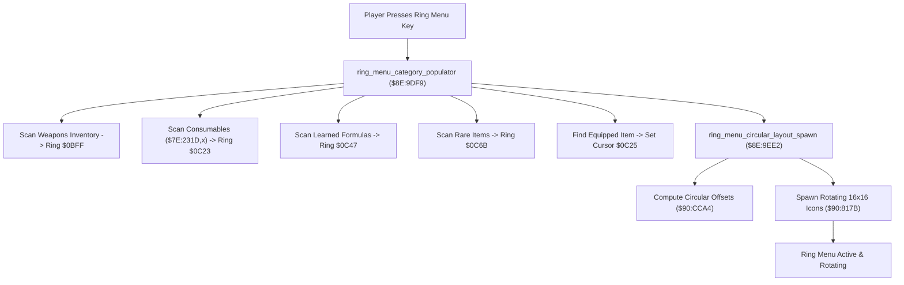

# Ring Menu Populator & Circular Layout Engine

- **ROM Locations**:
  - `ring_menu_category_populator`: `$8E:9DF9` – `$8E:9EBD`
  - `ring_menu_circular_layout_spawn`: `$8E:9EE2` – `$8E:9F25`
  - `ring_menu_definitions`: `$C4:5ABE` (master ring item ID table)
- **CPU State**: 16-bit A/X (`REP #$30`), Data Bank `$8E` / `$7E`
- **WRAM Core Addresses**:
  - `$7E:231D,x`: Consumable and weapon item counts in inventory.
  - `$7E:0BFF`: Weapons ring category item count.
  - `$7E:0C01`: Weapons ring category cursor index.
  - `$7E:0C23`: Consumables ring category item count.
  - `$7E:0C25`: Consumables ring category cursor index.
  - `$7E:0C27`..`$7E:0C45`: Consumables ring slot array (up to 16 entries).
  - `$7E:0C47`: Alchemy formulas ring category item count.
  - `$7E:0C49`: Alchemy formulas ring category cursor index.
  - `$7E:0C6B`: Rare / Key items ring category item count.
  - `$7E:0C6D`: Rare / Key items ring category cursor index.
  - `$7E:0DDB`: Boy ring sprite actor pointer.
  - `$7E:0DEB`: Dog ring sprite actor pointer.

---

## 1. Architectural Architecture & Ring Construction

When the player presses Select/X/Y to open the ring menu, the game dynamically scans player inventory arrays to construct the active wheel.

### 1. The 4 Ring Categories
- Category 0: **Weapons** (Swords, Axes, Spears, Bazookas)
- Category 1: **Consumables** (Petals, Nectar, Honey, Wings, Dog Biscuits, Essence)
- Category 2: **Alchemy Formulas** (Offensive, Defensive, Utility spells)
- Category 3: **Rare / Key Items** (Wheel, Gauge, Diamond Eyes, Energy Core)

### 2. Cursor Positioning
During the ring build loop, each item ID is compared against the currently equipped item (`$0AC2`). When a match occurs, the active ring cursor index (`$0C25`) is immediately seeded to that slot so the ring opens focused on the player's current selection.

---

## 2. Disassembly & Annotations

### Part 1: Consumable Ring Population Loop (`$8E:9DF9`)
> **Interactive 65816 Assembly**:
> Centralized comments infused at runtime.
> [View in VFS: soe://rom/code/8E9DF9](soe://rom/code/8E9DF9?asm=1&c=0)

### Part 2: Circular Coordinates & Icon Spawner (`$8E:9EE2`)
> **Interactive 65816 Assembly**:
> Centralized comments infused at runtime.
> [View in VFS: soe://rom/code/8E9DF9](soe://rom/code/8E9DF9?asm=1&c=0)

---

## 3. Reconstructed Clean C Implementation

> **Reconstructed C Decompilation**:
> Source moved to [`reconstructed-c/8E/8E9DF9_ring_menu_builder.c`](../../../reconstructed-c/8E/8E9DF9_ring_menu_builder.c).
> [View in VFS: soe://rom/code/8E9DF9](soe://rom/code/8E9DF9?c=1&asm=0)

