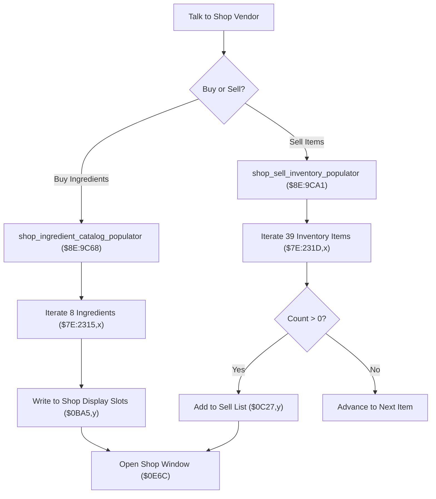

# Shop Inventory & Ingredient Catalog Populators

- **ROM Locations**:
  - `shop_ingredient_catalog_populator`: `$8E:9C68` – `$8E:9CA0`
  - `shop_sell_inventory_populator`: `$8E:9CA1` – `$8E:9CDC`
  - `shop_alchemy_definitions`: `$C4:5AAE`
  - `shop_item_definitions`: `$C4:5ABE`
- **CPU State**: 16-bit A/X (`REP #$30`), Data Bank `$8E` / `$7E`
- **WRAM Core Addresses**:
  - `$7E:2315,x`: Alchemy ingredient inventory counts (8 bytes).
  - `$7E:231D,x`: Consumable and weapon item counts (39 bytes).
  - `$7E:0BA1`: Shop buy catalog populated item count.
  - `$7E:0BA3`: Shop buy catalog active cursor index.
  - `$7E:0BA5,y`: Shop buy catalog display slots array.
  - `$7E:0C23`: Shop sell menu populated item count.
  - `$7E:0C27,y`: Shop sell menu display slots array.

---

## 1. Architectural Architecture & Catalog Pipeline

When visiting vendors across the four eras, the shop engine constructs dynamic transaction lists from master tables in Bank `$C4` and player inventory arrays in Bank `$7E`.

### 1. Alchemy Ingredient Buy Catalog (`$8E:9C68`)
- Iterates 8 ingredient slots (`LDA #8`, `STA $42`).
- Reads held counts from `$7E:2315,X`.
- If owned/available, extracts definition from `$C4:5AAE,X` and writes to slot array `$0BA5,Y`.
- Maintains the total offer count in `$0BA1` and clamps the cursor index `$0BA3`.

### 2. Sell Inventory Catalog (`$8E:9CA1`)
- Scans all 39 general inventory slots (`LDA #$27`, `STA $42`).
- Reads inventory quantity at `$7E:231D,X`.
- Filters out zero-quantity items so the sell list only displays items currently in the satchel.
- Populates eligible sell items into `$0C27,Y` and updates `$0C23`.

---

## 2. Disassembly & Annotations

### Part 1: Alchemy Buy Catalog Populator (`$8E:9C68`)
> **Interactive 65816 Assembly**:
> Centralized comments infused at runtime.
> [View in VFS: soe://rom/code/8E9C68](soe://rom/code/8E9C68?asm=1&c=0)

### Part 2: Sell Inventory Populator (`$8E:9CA1`)
> **Interactive 65816 Assembly**:
> Centralized comments infused at runtime.
> [View in VFS: soe://rom/code/8E9C68](soe://rom/code/8E9C68?asm=1&c=0)

---

## 3. Reconstructed Clean C Implementation

> **Reconstructed C Decompilation**:
> Source moved to [`reconstructed-c/8E/8E9C68_shop_catalogs.c`](../../../reconstructed-c/8E/8E9C68_shop_catalogs.c).
> [View in VFS: soe://rom/code/8E9C68](soe://rom/code/8E9C68?c=1&asm=0)

