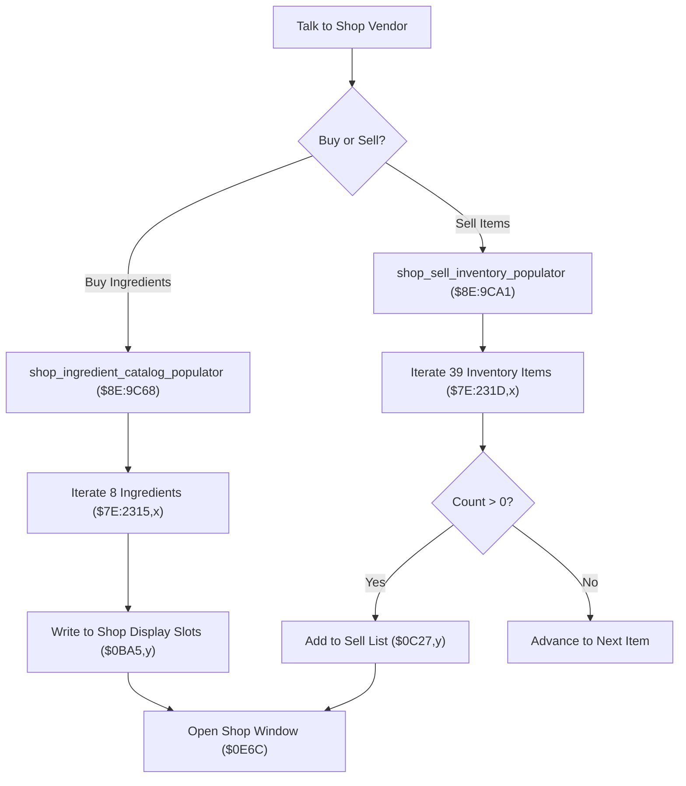

# Shop Inventory & Ingredient Catalog Populators

- **ROM Locations**:
  - `shop_ingredient_catalog_populator`: `$8E:9C68` – `$8E:9CA0`
  - `shop_sell_inventory_populator`: `$8E:9CA1` – `$8E:9CDC`
  - `shop_alchemy_definitions`: `$C4:5AAE`
  - `shop_item_definitions`: `$C4:5ABE`
- **CPU State**: 16-bit A/X (`REP #$30`), Data Bank `$8E` / `$7E`
- **WRAM Core Addresses**:
  - `$7E:2315,x`: Alchemy ingredient inventory counts (8 bytes).
  - `$7E:231D,x`: Consumable and weapon item counts (39 bytes).
  - `$7E:0BA1`: Shop buy catalog populated item count.
  - `$7E:0BA3`: Shop buy catalog active cursor index.
  - `$7E:0BA5,y`: Shop buy catalog display slots array.
  - `$7E:0C23`: Shop sell menu populated item count.
  - `$7E:0C27,y`: Shop sell menu display slots array.

---

## 1. Architectural Architecture & Catalog Pipeline

When visiting vendors across the four eras, the shop engine constructs dynamic transaction lists from master tables in Bank `$C4` and player inventory arrays in Bank `$7E`.



### 1. Alchemy Ingredient Buy Catalog (`$8E:9C68`)
- Iterates 8 ingredient slots (`LDA #8`, `STA $42`).
- Reads held counts from `$7E:2315,X`.
- If owned/available, extracts definition from `$C4:5AAE,X` and writes to slot array `$0BA5,Y`.
- Maintains the total offer count in `$0BA1` and clamps the cursor index `$0BA3`.

### 2. Sell Inventory Catalog (`$8E:9CA1`)
- Scans all 39 general inventory slots (`LDA #$27`, `STA $42`).
- Reads inventory quantity at `$7E:231D,X`.
- Filters out zero-quantity items so the sell list only displays items currently in the satchel.
- Populates eligible sell items into `$0C27,Y` and updates `$0C23`.

---

## 2. Disassembly & Annotations

### Part 1: Alchemy Buy Catalog Populator (`$8E:9C68`)
```assembly
; ==============================================================================
; shop_ingredient_catalog_populator ($8E:9C68)
; ==============================================================================
$8E9C68  A9 08 00    LDA #$0008        ; 8 ingredient slots
$8E9C6B  85 42       STA $42           ; Loop counter = 8
$8E9C6D  A0 00 00    LDY #$0000        ; Output slot write index Y = 0
$8E9C70  9C A1 0B    STZ $0BA1         ; Total catalog count = 0
$8E9C73  64 12       STZ $12           ; Ingredient index = 0

.loop:
$8E9C75  AE 12 00    LDX $0012         ; Load current ingredient index
$8E9C77  BF 15 23 7E LDA $7E2315,X     ; Read ingredient inventory count
$8E9C7B  29 FF 00    AND #$00FF
$8E9C7E  F0 0F       BEQ .next         ; If 0, skip slot

$8E9C80  8A          TXA
$8E9C81  0A          ASL A             ; 2 bytes per table entry
$8E9C82  AA          TAX
$8E9C83  BF AE 5A C4 LDA $C45AAE,X     ; Load ingredient shop record from $C4:5AAE
$8E9C87  99 A5 0B    STA $0BA5,Y       ; Store into catalog display slot
$8E9C8A  C8          INY
$8E9C8B  C8          INY               ; Y += 2
$8E9C8C  EE A1 0B    INC $0BA1         ; Catalog count++

.next:
$8E9C8F  E6 12       INC $12           ; Ingredient index++
$8E9C91  C6 42       DEC $42           ; Decrement loop counter
$8E9C93  D0 E0       BNE .loop         ; Loop until all 8 slots checked

$8E9C95  AD A3 0B    LDA $0BA3         ; Active cursor index
$8E9C98  CD A1 0B    CMP $0BA1         ; Compare against total count
$8E9C9B  30 03       BMI .done
$8E9C9D  9C A3 0B    STZ $0BA3         ; Clamp cursor = 0 if out of range
.done:
$8E9CA0  6B          RTL
```

### Part 2: Sell Inventory Populator (`$8E:9CA1`)
```assembly
; ==============================================================================
; shop_sell_inventory_populator ($8E:9CA1)
; ==============================================================================
$8E9CA1  A9 27 00    LDA #$0027        ; 39 inventory slots (0x27)
$8E9CA4  85 42       STA $42           ; Loop counter = 39
$8E9CA6  A0 00 00    LDY #$0000
$8E9CA9  9C 23 0C    STZ $0C23         ; Sell menu count = 0
$8E9CAC  64 12       STZ $12

.sell_loop:
$8E9CAE  AE 12 00    LDX $0012
$8E9CB0  BF 1D 23 7E LDA $7E231D,X     ; Read item count
$8E9CB4  29 FF 00    AND #$00FF
$8E9CB7  F0 0F       BEQ .skip_sell    ; Only show items the player owns

$8E9CB9  8A          TXA
$8E9CBA  0A          ASL A
$8E9CBB  AA          TAX
$8E9CBC  BF BE 5A C4 LDA $C45ABE,X     ; Load item ID from master table $C4:5ABE
$8E9CC0  99 27 0C    STA $0C27,Y       ; Store into sell menu array
$8E9CC3  C8          INY
$8E9CC4  C8          INY
$8E9CC5  EE 23 0C    INC $0C23         ; Increment sell menu count

.skip_sell:
$8E9CC8  E6 12       INC $12
$8E9CCA  C6 42       DEC $42
$8E9CCC  D0 E0       BNE .sell_loop
$8E9CCE  6B          RTL
```

---

## 3. Reconstructed Clean C Implementation

```c
#include <stdint.h>
#include <stdbool.h>

#define MAX_ALCHEMY_SLOTS       8
#define MAX_INVENTORY_ITEMS     39
#define MAX_DISPLAY_SLOTS       16

typedef struct {
    uint16_t catalog_count;                  // $7E:0BA1
    uint16_t cursor_index;                  // $7E:0BA3
    uint16_t display_slots[MAX_DISPLAY_SLOTS]; // $7E:0BA5,y
} ShopBuyCatalog;

typedef struct {
    uint16_t sell_count;                     // $7E:0C23
    uint16_t sell_slots[MAX_INVENTORY_ITEMS];// $7E:0C27,y
} ShopSellMenu;

extern ShopBuyCatalog g_shop_buy;
extern ShopSellMenu   g_shop_sell;

extern uint8_t g_ingredient_inventory[MAX_ALCHEMY_SLOTS]; // $7E:2315
extern uint8_t g_general_inventory[MAX_INVENTORY_ITEMS];  // $7E:231D

// Master definition tables (Bank $C4)
extern const uint16_t g_shop_alchemy_records[]; // $C4:5AAE
extern const uint16_t g_shop_item_records[];    // $C4:5ABE

/**
 * Scans player ingredient inventory and populates the shop buy catalog.
 * Corresponds to $8E:9C68.
 */
void shop_ingredient_catalog_populator(void) {
    g_shop_buy.catalog_count = 0;
    uint16_t write_idx = 0;

    for (int i = 0; i < MAX_ALCHEMY_SLOTS; i++) {
        if (g_ingredient_inventory[i] != 0) {
            uint16_t record = g_shop_alchemy_records[i];
            g_shop_buy.display_slots[write_idx++] = record;
            g_shop_buy.catalog_count++;
            if (write_idx >= MAX_DISPLAY_SLOTS) break;
        }
    }

    // Clamp cursor index if past catalog boundary
    if (g_shop_buy.cursor_index >= g_shop_buy.catalog_count) {
        g_shop_buy.cursor_index = 0;
    }
}

/**
 * Scans general inventory and populates the shop sell menu with owned items.
 * Corresponds to $8E:9CA1.
 */
void shop_sell_inventory_populator(void) {
    g_shop_sell.sell_count = 0;
    uint16_t write_idx = 0;

    for (int i = 0; i < MAX_INVENTORY_ITEMS; i++) {
        if (g_general_inventory[i] != 0) {
            uint16_t item_id = g_shop_item_records[i];
            g_shop_sell.sell_slots[write_idx++] = item_id;
            g_shop_sell.sell_count++;
        }
    }
}
```
