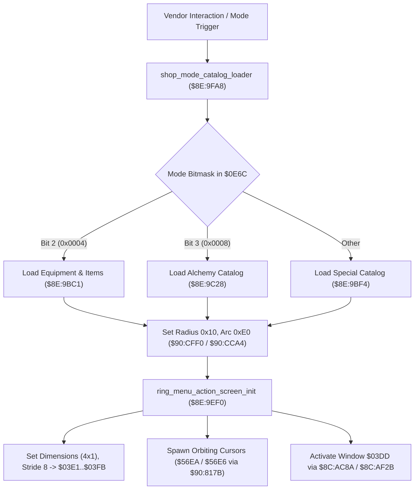

# Shop Mode Dispatcher, Carousel Geometry & Ingredient Satchel Logic

- **ROM Locations**:
  - `alchemy_ingredient_satchel_deduct`: `$8E:9140` – `$8E:9176`
  - `ring_menu_action_screen_init`: `$8E:9EF0` – `$8E:9F85`
  - `shop_mode_catalog_loader`: `$8E:9FA8` – `$8E:A030`
- **CPU State**: 16-bit A/X (`REP #$30`), Data Bank `$7E` / `$8E`
- **WRAM Core Addresses**:
  - `$7E:2315,x`: 8-slot alchemy ingredient inventory satchel counts.
  - `$7E:0E6C`: Shop mode configuration bitmask (bit 2: standard items/armor, bit 3: alchemy ingredients).
  - `$7E:03E1` / `$7E:03E3`: Active submenu window dimensions (4 columns $\times$ 1 row).
  - `$7E:03F1`: VRAM tile offset (`0x0014`).
  - `$7E:03F9`: Cursor stride (`0x0008`).
  - `$7E:03FB`: Active options count (`0x0002`).
  - `$7E:0403`: Localized menu string pointer (`0x1924`).
  - DP `$02`: Carousel orbit radius (`0x0010`).
  - DP `$04`: Carousel arc angle span (`0x00E0`).

---

## 1. Subsystem Architecture

When the player enters a shop vendor interface or completes an alchemy purchase, the engine coordinates inventory deduction, sub-window layout initialization, and dynamic carousel orbit projection.

### 1. Ingredient Satchel Depletion (`$8E:9140`)
- Reads sub-item index from descriptor field `+0x06`.
- Decrements player ingredient count in `$7E:2315,x`.
- If remaining quantity reaches 0 (`BEQ $8E915B`), calls `shop_ingredient_catalog_populator` (`$8E:9C68`) to purge empty entries from the shop view.
- If all slots in the category become empty, sets flag `0x0010` in `$7E:05A9` and auto-closes via `$8E:AD67`.

### 2. Sub-Window Initialization & Geometry (`$8E:9EF0`)
- Configures sub-window record dimensions: horizontal width 4 (`$03E1`), vertical height 1 (`$03E3`), VRAM tile offset 20 (`$03F1`), cursor step stride 8 (`$03F9`), and string key table `$1924` (`$0403`).
- Spawns rotating cursor sprite actors `$56EA` and `$56E6` via `$90:817B`.
- Activates and applies focus to window `$03DD` through `$8C:AC8A` and `$8C:AF2B`.

### 3. Shop Mode View Routing (`$8E:9FA8`)
- Inspects `$7E:0E6C`:
  - Bit 2 (`0x0004`): Standard equipment / consumable catalog via `$8E:9BC1`.
  - Bit 3 (`0x0008`): Alchemy ingredient vendor catalog via `$8E:9C28`.
  - Default: Rare/special items vendor catalog via `$8E:9BF4`.
- Configures ring radius to 16 pixels (`DP $02 = 0x0010`) and angular span to $224^\circ$ (`DP $04 = 0x00E0`), invoking circular positioning routines `$90:CFF0` and `$90:CCA4`.

---

## 2. Disassembly & Annotations

> **Interactive 65816 Assembly**:
> Centralized comments infused at runtime.
> [View in VFS: soe://rom/code/8E9140](soe://rom/code/8E9140?asm=1&c=0)

---

## 3. Reconstructed Clean C Implementation

> **Reconstructed C Decompilation**:
> Source moved to [`reconstructed-c/8E/8E9140_shop_mode_selector.c`](../../../reconstructed-c/8E/8E9140_shop_mode_selector.c).
> [View in VFS: soe://rom/code/8E9140](soe://rom/code/8E9140?c=1&asm=0)

