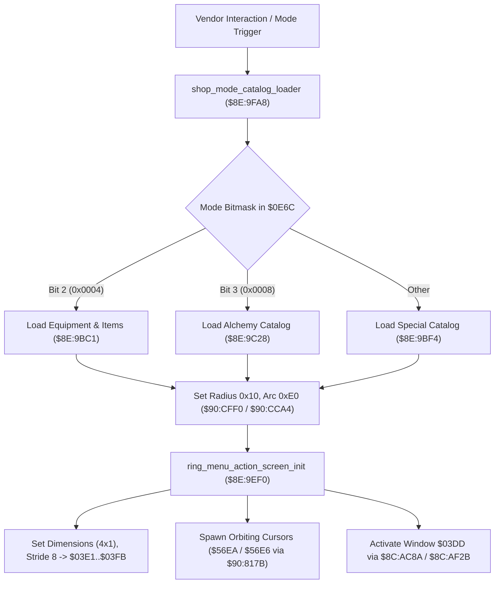

# Shop Mode Dispatcher, Carousel Geometry & Ingredient Satchel Logic

- **ROM Locations**:
  - `alchemy_ingredient_satchel_deduct`: `$8E:9140` – `$8E:9176`
  - `ring_menu_action_screen_init`: `$8E:9EF0` – `$8E:9F85`
  - `shop_mode_catalog_loader`: `$8E:9FA8` – `$8E:A030`
- **CPU State**: 16-bit A/X (`REP #$30`), Data Bank `$7E` / `$8E`
- **WRAM Core Addresses**:
  - `$7E:2315,x`: 8-slot alchemy ingredient inventory satchel counts.
  - `$7E:0E6C`: Shop mode configuration bitmask (bit 2: standard items/armor, bit 3: alchemy ingredients).
  - `$7E:03E1` / `$7E:03E3`: Active submenu window dimensions (4 columns $\times$ 1 row).
  - `$7E:03F1`: VRAM tile offset (`0x0014`).
  - `$7E:03F9`: Cursor stride (`0x0008`).
  - `$7E:03FB`: Active options count (`0x0002`).
  - `$7E:0403`: Localized menu string pointer (`0x1924`).
  - DP `$02`: Carousel orbit radius (`0x0010`).
  - DP `$04`: Carousel arc angle span (`0x00E0`).

---

## 1. Subsystem Architecture

When the player enters a shop vendor interface or completes an alchemy purchase, the engine coordinates inventory deduction, sub-window layout initialization, and dynamic carousel orbit projection.



### 1. Ingredient Satchel Depletion (`$8E:9140`)
- Reads sub-item index from descriptor field `+0x06`.
- Decrements player ingredient count in `$7E:2315,x`.
- If remaining quantity reaches 0 (`BEQ $8E915B`), calls `shop_ingredient_catalog_populator` (`$8E:9C68`) to purge empty entries from the shop view.
- If all slots in the category become empty, sets flag `0x0010` in `$7E:05A9` and auto-closes via `$8E:AD67`.

### 2. Sub-Window Initialization & Geometry (`$8E:9EF0`)
- Configures sub-window record dimensions: horizontal width 4 (`$03E1`), vertical height 1 (`$03E3`), VRAM tile offset 20 (`$03F1`), cursor step stride 8 (`$03F9`), and string key table `$1924` (`$0403`).
- Spawns rotating cursor sprite actors `$56EA` and `$56E6` via `$90:817B`.
- Activates and applies focus to window `$03DD` through `$8C:AC8A` and `$8C:AF2B`.

### 3. Shop Mode View Routing (`$8E:9FA8`)
- Inspects `$7E:0E6C`:
  - Bit 2 (`0x0004`): Standard equipment / consumable catalog via `$8E:9BC1`.
  - Bit 3 (`0x0008`): Alchemy ingredient vendor catalog via `$8E:9C28`.
  - Default: Rare/special items vendor catalog via `$8E:9BF4`.
- Configures ring radius to 16 pixels (`DP $02 = 0x0010`) and angular span to $224^\circ$ (`DP $04 = 0x00E0`), invoking circular positioning routines `$90:CFF0` and `$90:CCA4`.

---

## 2. Disassembly & Annotations

```assembly
; ==============================================================================
; alchemy_ingredient_satchel_deduct ($8E:9140)
; ==============================================================================
$8E9140  AA          TAX
$8E9141  BF 00 80 8E LDA $8E8000,x     ; Read descriptor pointer
$8E9145  AA          TAX
$8E9146  BF 06 00 8E LDA $8E0006,x     ; Read sub-item ID
$8E914A  AA          TAX
$8E914B  E2 20       SEP #$20
$8E914D  BD 15 23    LDA $2315,x       ; Load ingredient count in satchel
$8E9150  3A          DEC A             ; Decrement quantity
$8E9151  9D 15 23    STA $2315,x       ; Store updated quantity
$8E9154  C2 20       REP #$20
$8E9156  F0 03       BEQ $8E915B       ; Depleted to zero?
$8E9158  AB          PLB
$8E9159  18          CLC
$8E915A  60          RTS

; Handle Zero Depletion:
$8E915B  AB          PLB
$8E915C  22 68 9C 8E JSL $8E9C68       ; shop_ingredient_catalog_populator
$8E9160  A4 95       LDY $95
$8E9162  B9 00 00    LDA $0000,y
$8E9165  D0 0A       BNE $8E9171
$8E9167  A9 10 00    LDA #$0010
$8E916A  8D A9 05    STA $05A9
$8E916D  5C 67 AD 8E JML $8EAD67       ; Close ring menu if empty

$8E9171  7B          TDC
$8E9172  99 02 00    STA $0002,y
$8E9175  A9 80 00    LDA #$0080
$8E9178  38          SEC
$8E9179  60          RTS

; ==============================================================================
; ring_menu_action_screen_init ($8E:9EF0)
; ==============================================================================
$8E9EF0  22 A4 CC 90 JSL $90CCA4       ; Compute circular arc geometry
$8E9EF4  A9 CB AA    LDA #$AACB
$8E9EF7  22 ED CE 90 JSL $90CEED
$8E9EFB  8D F7 0D    STA $0DF7
$8E9EFE  A9 EB AA    LDA #$AAEB
$8E9F01  22 ED CE 90 JSL $90CEED
$8E9F05  8D E7 0D    STA $0DE7
$8E9F08  A0 DB 0D    LDY #$0DDB
$8E9F0B  A2 EA 56    LDX #$56EA        ; Cursor sprite actor 1
$8E9F0E  22 7B 81 90 JSL $90817B       ; Spawn sprite
$8E9F12  A0 EB 0D    LDY #$0DEB
$8E9F15  A2 E6 56    LDX #$56E6        ; Cursor sprite actor 2
$8E9F18  22 7B 81 90 JSL $90817B       ; Spawn sprite
$8E9F1F  8D E7 03    STA $03E7
$8E9F25  8D E9 03    STA $03E9
$8E9F28  A9 04 00    LDA #$0004        ; Width = 4 columns
$8E9F2B  8D E1 03    STA $03E1
$8E9F2E  A9 01 00    LDA #$0001        ; Height = 1 row
$8E9F31  8D E3 03    STA $03E3
$8E9F40  A9 14 00    LDA #$0014        ; Tile offset = 20
$8E9F43  8D F1 03    STA $03F1
$8E9F46  A9 08 00    LDA #$0008        ; Stride = 8
$8E9F49  8D F9 03    STA $03F9
$8E9F4C  A9 02 00    LDA #$0002        ; Options = 2
$8E9F4F  8D FB 03    STA $03FB
$8E9F64  A9 24 19    LDA #$1924        ; String table pointer
$8E9F67  8D 03 04    STA $0403
$8E9F70  A0 DD 03    LDY #$03DD
$8E9F73  22 8A AC 8C JSL $8CAC8A       ; Activate window
$8E9F77  22 2B AF 8C JSL $8CAF2B       ; Set window focus
$8E9F7B  AF 48 23 7E LDA $7E2348
$8E9F85  60          RTS

; ==============================================================================
; shop_mode_catalog_loader ($8E:9FA8)
; ==============================================================================
$8E9FA8  AD 6C 0E    LDA $0E6C         ; Mode configuration flags
$8E9FAB  89 04 00    BIT #$0004        ; Standard shop?
$8E9FAE  F0 06       BEQ $8E9FB6
$8E9FB0  22 C1 9B 8E JSL $8E9BC1       ; shop_load_catalog
$8E9FB4  80 0F       BRA $8E9FC5
$8E9FB6  89 08 00    BIT #$0008        ; Alchemy shop?
$8E9FB9  F0 06       BEQ $8E9FC1
$8E9FBB  22 28 9C 8E JSL $8E9C28       ; Load alchemy ingredient catalog
$8E9FBF  80 04       BRA $8E9FC5
$8E9FC1  22 F4 9B 8E JSL $8E9BF4       ; Load special vendor catalog
$8E9FC5  A9 10 00    LDA #$0010        ; Radius = 16 pixels
$8E9FC8  85 02       STA $02
$8E9FCA  A9 E0 00    LDA #$00E0        ; Arc angle = 224 degrees
$8E9FCD  85 04       STA $04
$8E9FCF  22 F0 CF 90 JSL $90CFF0       ; Position icons on carousel
$8E9FD3  22 A4 CC 90 JSL $90CCA4       ; Commit carousel arc
$8E9FD7  A9 30 00    LDA #$0030
$8E9FDA  1C A9 05    TRB $05A9
$8E9FDD  60          RTS
```

---

## 3. Reconstructed Clean C Implementation

```c
#include <stdint.h>
#include <stdbool.h>

extern uint8_t  g_alchemy_satchel[8];      // $7E:2315,x
extern uint16_t g_shop_mode_flags;         // $7E:0E6C
extern uint16_t g_window_width;            // $7E:03E1
extern uint16_t g_window_height;           // $7E:03E3
extern uint16_t g_window_tile_offset;      // $7E:03F1
extern uint16_t g_window_cursor_stride;    // $7E:03F9
extern uint16_t g_window_options_count;    // $7E:03FB
extern uint16_t g_window_strings_ptr;      // $7E:0403
extern uint16_t g_system_flags;            // $7E:05A9

extern void shop_ingredient_catalog_populator(void);
extern void ring_menu_close_immediate(void);
extern void shop_load_catalog(void);
extern void shop_load_alchemy_catalog(void);
extern void shop_load_special_catalog(void);
extern void setup_carousel_orbit(uint16_t radius, uint16_t arc_angle);
extern void spawn_cursor_actors(uint16_t actor1, uint16_t actor2);
extern void activate_window(uint16_t window_id);
extern void focus_window(uint16_t window_id);

/**
 * Decrements ingredient satchel slot and refreshes the vendor buy list on depletion.
 * Corresponds to $8E:9140.
 */
bool alchemy_ingredient_satchel_deduct(uint8_t ingredient_slot) {
    if (ingredient_slot >= 8 || g_alchemy_satchel[ingredient_slot] == 0) {
        return false;
    }

    g_alchemy_satchel[ingredient_slot]--;

    // Dynamic rebuild if this was the last unit:
    if (g_alchemy_satchel[ingredient_slot] == 0) {
        shop_ingredient_catalog_populator();
    }

    return true;
}

/**
 * Initializes the sub-window layout, dimensions, cursor actors, and string pointers.
 * Corresponds to $8E:9EF0.
 */
void ring_menu_action_screen_init(void) {
    // 1. Configure 4x1 submenu grid
    g_window_width         = 4;
    g_window_height        = 1;
    g_window_tile_offset   = 0x0014;
    g_window_cursor_stride = 8;
    g_window_options_count = 2;
    g_window_strings_ptr   = 0x1924;

    // 2. Spawn rotating cursor sprite actors
    spawn_cursor_actors(0x56EA, 0x56E6);

    // 3. Activate and focus window $03DD
    activate_window(0x03DD);
    focus_window(0x03DD);
}

/**
 * Routes shop view modes (standard, alchemy, or special) and positions carousel icons.
 * Corresponds to $8E:9FA8.
 */
void shop_mode_catalog_loader(void) {
    // 1. Dispatch catalog loader by mode bitmask
    if (g_shop_mode_flags & 0x0004) {
        shop_load_catalog();
    } else if (g_shop_mode_flags & 0x0008) {
        shop_load_alchemy_catalog();
    } else {
        shop_load_special_catalog();
    }

    // 2. Establish circular layout geometry (16px radius, 224 degree arc)
    setup_carousel_orbit(0x0010, 0x00E0);

    // 3. Clear interaction flags
    g_system_flags &= ~0x0030;
}
```
