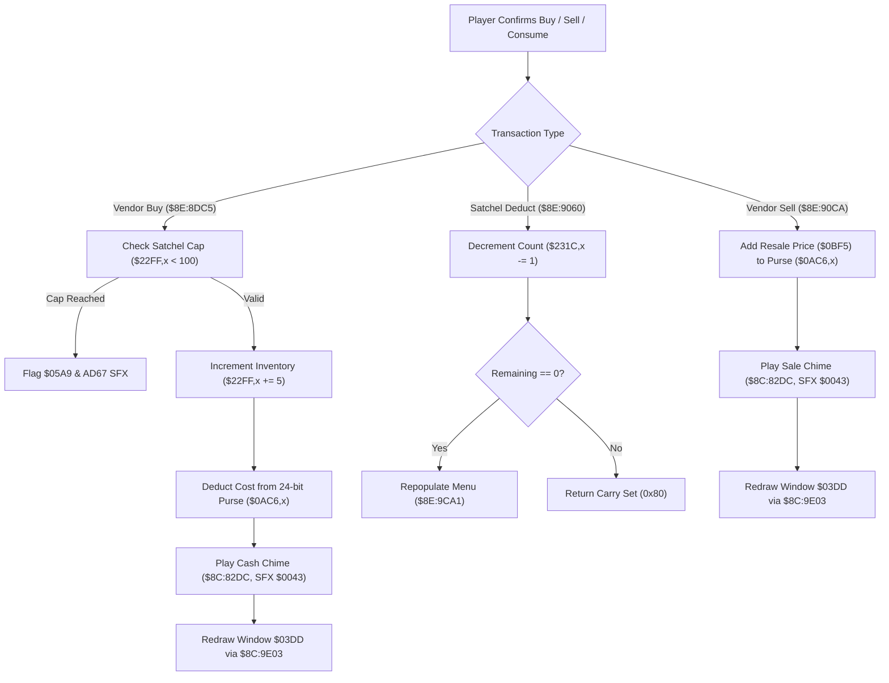

# Shop Transaction Pipeline & Satchel Inventory Deduction

- **ROM Locations**:
  - `shop_vendor_buy_commit`: `$8E:8DC5` – `$8E:8E39`
  - `consumable_item_satchel_deduct`: `$8E:9060` – `$8E:90CA`
  - `shop_vendor_sell_commit`: `$8E:90CA` – `$8E:9138`
- **CPU State**: 16-bit A/X (`REP #$30`), Data Bank `$7E` / `$8E`
- **WRAM Core Addresses**:
  - `$7E:0AC6,x` / `$7E:0AC8,x`: Active player 24-bit currency purse (low 16-bit word, high 8-bit byte).
  - `$7E:22FF,x`: Alchemy ingredient inventory slots ($0..$15, capped at 99 / `0x63`).
  - `$7E:231C,x` / `$7E:231D,x`: Consumable item satchel counts (Petals, Nectar, Honey, Wings, etc.).
  - `$7E:2348`: Currency category / active character index.
  - `$7E:0BF5`: Transaction price / item value register.
  - `$7E:2FF4`: Formatted numeric string buffer for dialogue display.
  - DP `$95`: Pointer to active ring/shop menu state structure.

---

## 1. Architecture & Transaction Flow

When trading with vendors (buying ingredients, selling excess loot) or using items from the satchel, the engine executes strict bounds validation, audio feedback, 24-bit purse math, and automatic UI catalog synchronization.



### 1. Vendor Buy Validation & Inventory Cap (`$8E:8DC5`)
- Reads current inventory count from `$7E:22FF,x`.
- Adds 5 units (`ADC #$05`).
- Compares with 100 (`CMP #$64`): if $\ge 100$, purchase is rejected with error buzz via `$AD67` and error bit `0x0020` in `$7E:05A9`.
- If valid, stores updated quantity, deducts cost from `$0AC6,x`, plays chime `$0043`, and formats the updated balance for UI window `$03DD`.

### 2. Satchel Item Deduction & Dynamic Re-filtering (`$8E:9060`)
- Identifies consumable item index from item descriptor field `+0x06` (`LSR A`).
- Decrements inventory count in satchel array `$7E:231C,x`.
- If the item count drops to zero (`BEQ $8E90AB`), triggers `shop_populate_sell_list` (`$8E:9CA1`) so the depleted item immediately vanishes from the ring/shop carousel without stale slots.

### 3. Vendor Sell Credit & 24-Bit Arithmetic (`$8E:90CA`)
- Pulls item resale value from register `$7E:0BF5`.
- Adds value to the lower 16-bit purse word at `$7E:0AC6,x`.
- Carries overflow (`SEP #$20; ADC $0AC8,x`) into the upper 8-bit bank byte at `$7E:0AC8,x`.
- Dispatches sound effect `$0043` and syncs the on-screen cash readout.

---

## 2. Disassembly & Annotations

```assembly
; ==============================================================================
; shop_vendor_buy_commit ($8E:8DC5)
; Input:
;   DP $12 = Ingredient index
;   DP $0A / $0C = Current balance and cost
; ==============================================================================
$8E8DC5  A6 12       LDX $12           ; Ingredient index
$8E8DC7  E2 20       SEP #$20          ; 8-bit accumulator
$8E8DC9  BD FF 22    LDA $22FF,x       ; Load current ingredient count
$8E8DCC  18          CLC
$8E8DCD  69 05       ADC #$05          ; Buying a batch of 5 units
$8E8DCF  C9 64       CMP #$64          ; Max 99 items (100 cap)
$8E8DD1  30 0C       BMI $8E8DDF       ; If valid (< 100), commit purchase!

; Rejection handling:
$8E8DD3  C2 20       REP #$20          ; 16-bit accumulator
$8E8DD5  A9 20 00    LDA #$0020        ; Transaction failure bit
$8E8DD8  0C A9 05    TSB $05A9
$8E8DDB  AB          PLB
$8E8DDC  4C 67 AD    JMP $AD67         ; Error sound and return

; Commit Purchase:
$8E8DDF  9D FF 22    STA $22FF,x       ; Store new ingredient count
$8E8DE2  C2 20       REP #$20
$8E8DE4  AB          PLB
$8E8DE5  48          PHA
$8E8DE6  DA          PHX
$8E8DE7  5A          PHY
$8E8DE8  A9 43 00    LDA #$0043        ; Cash register / buy chime SFX
$8E8DEB  22 DC 82 8C JSL $8C82DC       ; play_sound_effect_direct
$8E8DEF  7A          PLY
$8E8DF0  FA          PLX
$8E8DF1  68          PLA
$8E8DF2  AF 48 23 7E LDA $7E2348       ; Load active currency index
$8E8DF6  29 FF 00    AND #$00FF
$8E8DF9  AA          TAX
$8E8DFA  A5 0A       LDA $0A           ; Updated balance low word
$8E8DFC  9F C6 0A 00 STA $000AC6,x     ; Save purse low word
$8E8E00  A5 0B       LDA $0B           ; Updated balance high word
$8E8E02  9F C7 0A 00 STA $000AC7,x     ; Save purse high word
$8E8E06  A0 DD 03    LDY #$03DD        ; Window descriptor index
$8E8E09  22 2B AF 8C JSL $8CAF2B       ; Set window focus
$8E8E0D  AF 48 23 7E LDA $7E2348
$8E8E11  29 FF 00    AND #$00FF
$8E8E14  AA          TAX
$8E8E15  BD C6 0A    LDA $0AC6,x       ; Load new purse balance
$8E8E18  85 02       STA $02
$8E8E1A  BD C8 0A    LDA $0AC8,x
$8E8E1D  29 FF 00    AND #$00FF
$8E8E20  85 04       STA $04
$8E8E22  A9 F4 2F    LDA #$2FF4        ; String formatting buffer
$8E8E25  85 22       STA $22
$8E8E27  A9 7E 00    LDA #$007E
$8E8E2A  85 24       STA $24
$8E8E2C  22 1F B2 80 JSL $80B21F       ; Format number to string
$8E8E30  A0 DD 03    LDY #$03DD
$8E8E33  22 03 9E 8C JSL $8C9E03       ; Redraw window text
$8E8E37  18          CLC               ; Success return
$8E8E38  60          RTS

; ==============================================================================
; consumable_item_satchel_deduct ($8E:9060)
; ==============================================================================
$8E9060  C6 0A       DEC $0A
$8E9062  85 02       STA $02
; ...
$8E9095  BF 06 00 8E LDA $8E0006,x     ; Sub-item ID from descriptor
$8E9099  4A          LSR A
$8E909A  AA          TAX
$8E909B  E2 20       SEP #$20
$8E909D  BD 1C 23    LDA $231C,x       ; Consumable quantity in satchel
$8E90A0  3A          DEC A             ; Consume one item
$8E90A1  9D 1C 23    STA $231C,x       ; Update inventory
$8E90A4  C2 20       REP #$20
$8E90A6  F0 03       BEQ $8E90AB       ; Depleted to zero?
$8E90A8  AB          PLB
$8E90A9  18          CLC
$8E90AA  60          RTS

; Handle Satchel Depletion:
$8E90AB  AB          PLB
$8E90AC  22 A1 9C 8E JSL $8E9CA1       ; shop_populate_sell_list: rebuild active ring!
$8E90B0  A4 95       LDY $95
$8E90B2  B9 00 00    LDA $0000,y
$8E90B5  D0 0A       BNE $8E90C1
$8E90B7  A9 10 00    LDA #$0010        ; Ring empty flag
$8E90BA  8D A9 05    STA $05A9
$8E90BD  5C 67 AD 8E JML $8EAD67       ; Close ring menu

$8E90C1  7B          TDC
$8E90C2  99 02 00    STA $0002,y
$8E90C5  A9 80 00    LDA #$0080
$8E90C8  38          SEC
$8E90C9  60          RTS

; ==============================================================================
; shop_vendor_sell_commit ($8E:90CA)
; Input:
;   $7E:0BF5 = Resale credit value
; ==============================================================================
$8E90CA  22 97 85 80 JSL $808597       ; Context save
$8E90CE  8B          PHB
$8E90CF  F4 7E 7E    PEA $7E7E
$8E90D2  AB          PLB
$8E90D3  AB          PLB
$8E90D4  AD 48 23    LDA $2348         ; Currency index
$8E90D7  29 FF 00    AND #$00FF
$8E90DA  AA          TAX
$8E90DB  BD C6 0A    LDA $0AC6,x       ; Purse low 16 bits
$8E90DE  18          CLC
$8E90DF  6D F5 0B    ADC $0BF5         ; Add item resale price
$8E90E2  9D C6 0A    STA $0AC6,x
$8E90E5  E2 20       SEP #$20          ; 8-bit carry commit
$8E90E7  A9 00       LDA #$00
$8E90E9  7D C8 0A    ADC $0AC8,x       ; Add carry into upper 8 bits
$8E90EC  9D C8 0A    STA $0AC8,x
$8E90EF  C2 20       REP #$20
$8E90F1  8B          PHB
$8E90F2  4B          PHK
$8E90F3  AB          PLB
$8E90F7  A9 43 00    LDA #$0043        ; Sale cash chime SFX
$8E90FA  22 DC 82 8C JSL $8C82DC       ; play_sound_effect_direct
$8E9104  22 2B AF 8C JSL $8CAF2B       ; Set window focus
$8E912C  22 1F B2 80 JSL $80B21F       ; Format string
$8E912E  22 03 9E 8C JSL $8C9E03       ; Redraw window
$8E9132  AB          PLB
$8E9133  A4 95       LDY $95
$8E9135  B9 02 00    LDA $0002,y
$8E9138  60          RTS
```

---

## 3. Reconstructed Clean C Implementation

```c
#include <stdint.h>
#include <stdbool.h>

#define MAX_INGREDIENTS 100
#define SFX_PURCHASE_COIN 0x0043

extern uint8_t  g_ingredient_inventory[22];    // $7E:22FF,x
extern uint8_t  g_consumable_inventory[16];    // $7E:231C,x
extern uint16_t g_purse_low[4];                // $7E:0AC6,x
extern uint8_t  g_purse_high[4];               // $7E:0AC8,x
extern uint16_t g_currency_era;                // $7E:2348
extern uint16_t g_resale_value;                // $7E:0BF5
extern uint16_t g_system_interaction_flags;    // $7E:05A9
extern char     g_text_format_buffer[32];      // $7E:2FF4

extern void play_sound_effect_direct(uint16_t sfx_id);
extern void format_number_to_string(char *dest, uint32_t value);
extern void redraw_window_text(uint16_t window_id);
extern void ring_menu_rebuild_catalog(void);
extern void ring_menu_close_immediate(void);

/**
 * Commits purchase of 5 alchemy ingredients.
 * Corresponds to $8E:8DC5.
 */
bool shop_vendor_buy_commit(uint8_t ingredient_idx, uint32_t cost) {
    if (ingredient_idx >= 22) return false;

    // 1. Check max inventory cap (99 items)
    uint8_t current_qty = g_ingredient_inventory[ingredient_idx];
    if (current_qty + 5 >= MAX_INGREDIENTS) {
        g_system_interaction_flags |= 0x0020; // Rejection bit
        return false;
    }

    // 2. Commit inventory addition
    g_ingredient_inventory[ingredient_idx] = current_qty + 5;

    // 3. Play purchase chime audio
    play_sound_effect_direct(SFX_PURCHASE_COIN);

    // 4. Deduct cost from active currency wallet
    uint8_t era = (uint8_t)(g_currency_era & 0x00FF);
    uint32_t current_funds = (uint32_t)g_purse_low[era] | ((uint32_t)g_purse_high[era] << 16);
    current_funds -= cost;
    g_purse_low[era] = (uint16_t)(current_funds & 0xFFFF);
    g_purse_high[era] = (uint8_t)((current_funds >> 16) & 0xFF);

    // 5. Format and refresh currency display in window $03DD
    format_number_to_string(g_text_format_buffer, current_funds);
    redraw_window_text(0x03DD);

    return true;
}

/**
 * Decrements consumable item in satchel and triggers catalog rebuild upon depletion.
 * Corresponds to $8E:9060.
 */
bool consumable_item_satchel_deduct(uint8_t item_subindex) {
    uint8_t slot = item_subindex >> 1;
    if (slot >= 16 || g_consumable_inventory[slot] == 0) {
        return false;
    }

    g_consumable_inventory[slot]--;

    // If completely depleted, rebuild ring carousel dynamically:
    if (g_consumable_inventory[slot] == 0) {
        ring_menu_rebuild_catalog();
    }

    return true;
}

/**
 * Commits resale of an item, crediting funds to the 24-bit purse.
 * Corresponds to $8E:90CA.
 */
void shop_vendor_sell_commit(uint16_t credit_price) {
    uint8_t era = (uint8_t)(g_currency_era & 0x00FF);

    // 24-bit purse addition
    uint32_t current_funds = (uint32_t)g_purse_low[era] | ((uint32_t)g_purse_high[era] << 16);
    current_funds += credit_price;
    g_purse_low[era] = (uint16_t)(current_funds & 0xFFFF);
    g_purse_high[era] = (uint8_t)((current_funds >> 16) & 0xFF);

    // Play coin sale chime
    play_sound_effect_direct(SFX_PURCHASE_COIN);

    // Refresh UI display
    format_number_to_string(g_text_format_buffer, current_funds);
    redraw_window_text(0x03DD);
}
```
