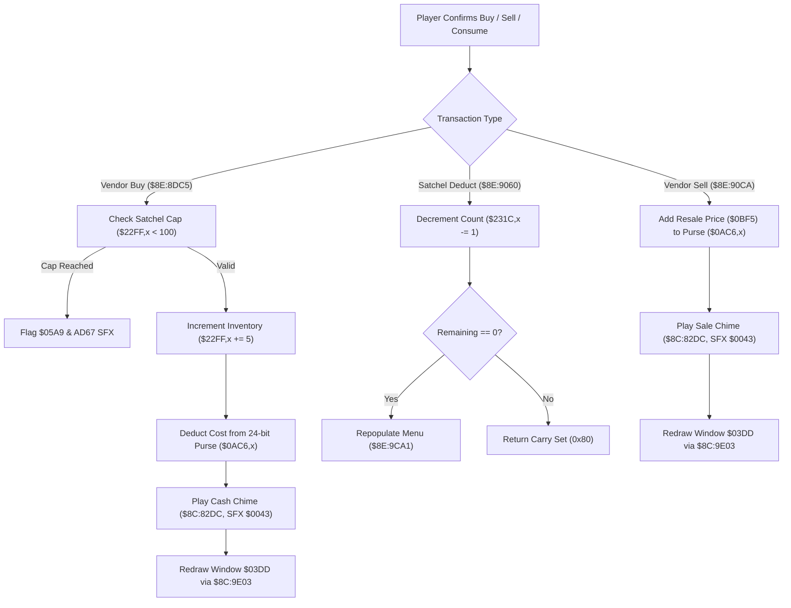

# Shop Transaction Pipeline & Satchel Inventory Deduction

- **ROM Locations**:
  - `shop_vendor_buy_commit`: `$8E:8DC5` – `$8E:8E39`
  - `consumable_item_satchel_deduct`: `$8E:9060` – `$8E:90CA`
  - `shop_vendor_sell_commit`: `$8E:90CA` – `$8E:9138`
- **CPU State**: 16-bit A/X (`REP #$30`), Data Bank `$7E` / `$8E`
- **WRAM Core Addresses**:
  - `$7E:0AC6,x` / `$7E:0AC8,x`: Active player 24-bit currency purse (low 16-bit word, high 8-bit byte).
  - `$7E:22FF,x`: Alchemy ingredient inventory slots ($0..$15, capped at 99 / `0x63`).
  - `$7E:231C,x` / `$7E:231D,x`: Consumable item satchel counts (Petals, Nectar, Honey, Wings, etc.).
  - `$7E:2348`: Currency category / active character index.
  - `$7E:0BF5`: Transaction price / item value register.
  - `$7E:2FF4`: Formatted numeric string buffer for dialogue display.
  - DP `$95`: Pointer to active ring/shop menu state structure.

---

## 1. Architecture & Transaction Flow

When trading with vendors (buying ingredients, selling excess loot) or using items from the satchel, the engine executes strict bounds validation, audio feedback, 24-bit purse math, and automatic UI catalog synchronization.

### 1. Vendor Buy Validation & Inventory Cap (`$8E:8DC5`)
- Reads current inventory count from `$7E:22FF,x`.
- Adds 5 units (`ADC #$05`).
- Compares with 100 (`CMP #$64`): if $\ge 100$, purchase is rejected with error buzz via `$AD67` and error bit `0x0020` in `$7E:05A9`.
- If valid, stores updated quantity, deducts cost from `$0AC6,x`, plays chime `$0043`, and formats the updated balance for UI window `$03DD`.

### 2. Satchel Item Deduction & Dynamic Re-filtering (`$8E:9060`)
- Identifies consumable item index from item descriptor field `+0x06` (`LSR A`).
- Decrements inventory count in satchel array `$7E:231C,x`.
- If the item count drops to zero (`BEQ $8E90AB`), triggers `shop_populate_sell_list` (`$8E:9CA1`) so the depleted item immediately vanishes from the ring/shop carousel without stale slots.

### 3. Vendor Sell Credit & 24-Bit Arithmetic (`$8E:90CA`)
- Pulls item resale value from register `$7E:0BF5`.
- Adds value to the lower 16-bit purse word at `$7E:0AC6,x`.
- Carries overflow (`SEP #$20; ADC $0AC8,x`) into the upper 8-bit bank byte at `$7E:0AC8,x`.
- Dispatches sound effect `$0043` and syncs the on-screen cash readout.

---

## 2. Disassembly & Annotations

> **Interactive 65816 Assembly**:
> Centralized comments infused at runtime.
> [View in VFS: soe://rom/code/8E8DC5](soe://rom/code/8E8DC5?asm=1&c=0)

---

## 3. Reconstructed Clean C Implementation

> **Reconstructed C Decompilation**:
> Source moved to [`reconstructed-c/8E/8E8DC5_shop_transactions.c`](../../../reconstructed-c/8E/8E8DC5_shop_transactions.c).
> [View in VFS: soe://rom/code/8E8DC5](soe://rom/code/8E8DC5?c=1&asm=0)

