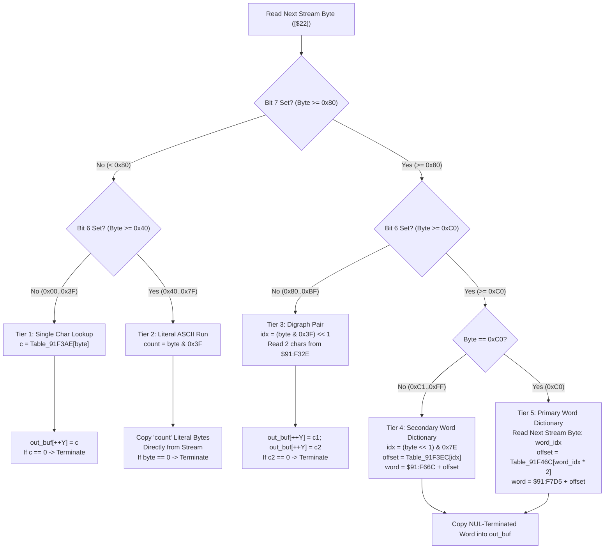

# Script VM String Dictionary & Digraph Expander ($8C:CD84 – $8C:CE29 / $91:F300 – $91:F9FF)

> **Subsystem**: Dialogue Engine & Script VM String Decompressor  
> **ROM Addresses**: `$8C:CD84` (`dialogue_string_dictionary_expand`), caller `$8C:CCF5` (`decode_dialogue_string_key`)  
> **ROM Data Tables**: `$91:F32E` (digraphs), `$91:F3AE` (single chars), `$91:F3EC` (secondary word pointers), `$91:F46C` (primary word pointers), `$91:F66C` (secondary word strings), `$91:F7D5` (primary word strings)  
> **Clean C Module**: `ui/string-dictionary.c`  
> **Recomp Symbols**: `func_CCCD84_M0X0`  
> **Confidence**: Confirmed  

---

## 1. Architectural Role

Secret of Evermore stores over 3,000 distinct dialogue and description strings in ROM (referenced via 3-byte descriptors starting at `$91:D000`). Because text is a substantial component of cart ROM, strings are compressed using a custom **5-tier token encoding** scheme designed to minimize ROM footprint while remaining fast enough to unpack in real-time directly into WRAM `$7F:D81E` before streaming glyphs into VRAM.

### Token Taxonomy

| Byte Range | Classification | Action | Table Location |
|---|---|---|---|
| `0x00 .. 0x3F` | **Single Character** | Look up single ASCII glyph | `$91:F3AE` (64 bytes) |
| `0x40 .. 0x7F` | **Literal Run** | Copy $(N = \text{byte} \ \& \ 0x3F)$ raw ASCII bytes | Stream in ROM |
| `0x80 .. 0xBF` | **Digraph** | Emit 2 frequent characters (e.g. `"th"`, `"e "`, `"in"`) | `$91:F32E` (64 bytes, 32 pairs) |
| `0xC0` | **Primary Word** | Consume next stream byte; look up in 256-word dictionary | Ptrs: `$91:F46C`, Data: `$91:F7D5` |
| `0xC1 .. 0xFF` | **Secondary Word** | Look up in 64-word secondary dictionary via $((\text{byte} \ll 1) \ \& \ 0x7E)$ | Ptrs: `$91:F3EC`, Data: `$91:F66C` |

---

## 2. Disassembly Analysis

> **Interactive 65816 Assembly**:
> Centralized comments infused at runtime.
> [View in VFS: soe://rom/code/8CCD84](soe://rom/code/8CCD84?asm=1&c=0)

---

## 3. Clean C Implementation

> **Reconstructed C Decompilation**:
> Source moved to [`reconstructed-c/8C/8CCD84_string_dictionary.c`](../../../reconstructed-c/8C/8CCD84_string_dictionary.c).
> [View in VFS: soe://rom/code/8CCD84](soe://rom/code/8CCD84?c=1&asm=0)

---

## 4. Behavioral Equivalence & Edge Cases

1. **Pre-decrement Indexing**:
   - In 65816 assembly, register `Y` is decremented at entry (`DEY`, `$8C:CD8A`), and every write uses `STA $0000,Y` immediately preceded by `INY`. This ensures the first output byte is written precisely at the initial caller offset (e.g. `0xD81E`).
2. **NUL Termination Invariant**:
   - String decoding terminates when:
     - A Tier 1 lookup yields `0x00` (`$8C:CDA7`).
     - A literal byte in Tier 2 equals `0x00` (`$8C:CDC0`).
     - The second byte of a Tier 3 digraph equals `0x00` (`$8C:CDDA`).
   - Words from Tier 4 and Tier 5 are internally NUL-terminated, which only ends that specific word without terminating the enclosing sentence.
3. **Stream Pointer Incrementation**:
   - The 24-bit pointer is stored in Direct Page `$22..$24`. Because it spans ROM banks (typically Bank `$C0`–`$C4`), 16-bit increments (`INC $22`) handle page crossings across `0x0000`–`0xFFFF` boundary with `INC $23`.
