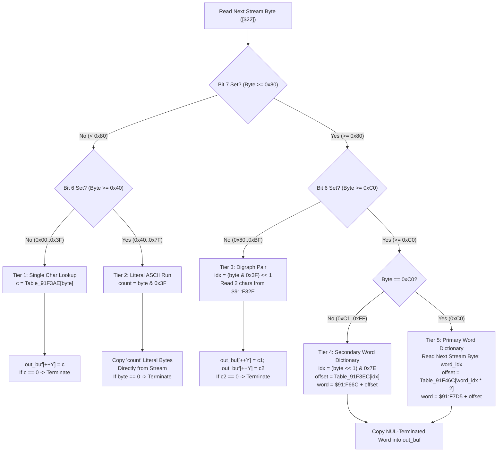

# Script VM String Dictionary & Digraph Expander ($8C:CD84 – $8C:CE29 / $91:F300 – $91:F9FF)

> **Subsystem**: Dialogue Engine & Script VM String Decompressor  
> **ROM Addresses**: `$8C:CD84` (`dialogue_string_dictionary_expand`), caller `$8C:CCF5` (`decode_dialogue_string_key`)  
> **ROM Data Tables**: `$91:F32E` (digraphs), `$91:F3AE` (single chars), `$91:F3EC` (secondary word pointers), `$91:F46C` (primary word pointers), `$91:F66C` (secondary word strings), `$91:F7D5` (primary word strings)  
> **Clean C Module**: `ui/string-dictionary.c`  
> **Recomp Symbols**: `func_CCCD84_M0X0`  
> **Confidence**: Confirmed  

---

## 1. Architectural Role

Secret of Evermore stores over 3,000 distinct dialogue and description strings in ROM (referenced via 3-byte descriptors starting at `$91:D000`). Because text is a substantial component of cart ROM, strings are compressed using a custom **5-tier token encoding** scheme designed to minimize ROM footprint while remaining fast enough to unpack in real-time directly into WRAM `$7F:D81E` before streaming glyphs into VRAM.



### Token Taxonomy

| Byte Range | Classification | Action | Table Location |
|---|---|---|---|
| `0x00 .. 0x3F` | **Single Character** | Look up single ASCII glyph | `$91:F3AE` (64 bytes) |
| `0x40 .. 0x7F` | **Literal Run** | Copy $(N = \text{byte} \ \& \ 0x3F)$ raw ASCII bytes | Stream in ROM |
| `0x80 .. 0xBF` | **Digraph** | Emit 2 frequent characters (e.g. `"th"`, `"e "`, `"in"`) | `$91:F32E` (64 bytes, 32 pairs) |
| `0xC0` | **Primary Word** | Consume next stream byte; look up in 256-word dictionary | Ptrs: `$91:F46C`, Data: `$91:F7D5` |
| `0xC1 .. 0xFF` | **Secondary Word** | Look up in 64-word secondary dictionary via $((\text{byte} \ll 1) \ \& \ 0x7E)$ | Ptrs: `$91:F3EC`, Data: `$91:F66C` |

---

## 2. Disassembly Analysis

```assembly
; ==============================================================================
; func_CCCD84: Dialogue String 5-Tier Dictionary and Digraph Expander
;
; Entry:
;   [$22] : 24-bit pointer to compressed token stream in ROM
;   Y     : Output offset in Bank $7F (typically $D81E)
;   DB    : Bank $8C (saved and switched to Bank $7F)
; Exit:
;   String written to $7F:Y, NUL-terminated
;   RTL
; ==============================================================================
$8C:CD84  8B           PHB              ; Save caller data bank
$8C:CD85  F4 7F 7F     PEA $7F7F        ; Push $7F7F
$8C:CD88  AB           PLB              ; Pull into DB -> DB = $7F
$8C:CD89  AB           PLB              ; Clean up second byte
$8C:CD8A  88           DEY              ; Pre-decrement Y so INY places first char at $D81E
$8C:CD8B  7B           TDC              ; Clear A (Transfer Direct Page to A)
$8C:CD8C  E2 20        SEP #$20         ; 8-bit accumulator (A=8-bit, X/Y=16-bit)
$8C:CD8E  80 06        BRA $CD96        ; Jump to token read

; --- Advance stream pointer and loop ---
$8C:CD90  E6 22        INC $22          ; Advance stream pointer low byte
$8C:CD92  D0 02        BNE $CD96
$8C:CD94  E6 23        INC $23          ; Advance stream pointer high byte

; --- Read token byte ---
$8C:CD96  A7 22        LDA [$22]        ; Read next token byte
$8C:CD98  30 2C        BMI $CDC6        ; If bit 7 is set (>= 0x80) -> branch to Digraph/Dictionary

; --- Tier 1 / Tier 2 branch ---
$8C:CD9A  0A           ASL A            ; Bit 6 into Carry and bit 7
$8C:CD9B  30 10        BMI $CDAD        ; If bit 6 was 1 (0x40..0x7F) -> Tier 2 Literal Run

; --- Tier 1: Single Character Lookup ($91:F3AE) ---
$8C:CD9D  C8           INY              ; Advance output buffer index
$8C:CD9E  4A           LSR A            ; Restore token value (0x00..0x3F)
$8C:CD9F  AA           TAX
$8C:CDA0  BF AE F3 91  LDA $91F3AE,X    ; Table lookup: single character
$8C:CDA4  99 00 00     STA $0000,Y      ; Write character to $7F:Y
$8C:CDA7  D0 E7        BNE $CD90        ; If character != 0, continue decoding
$8C:CDA9  C2 20        REP #$20         ; NUL terminator reached! Restore 16-bit A
$8C:CDAB  AB           PLB              ; Restore original caller Data Bank
$8C:CDAC  6B           RTL              ; Return

; --- Tier 2: Literal ASCII Run ($00..$3F bytes) ---
$8C:CDAD  4A           LSR A            ; Restore bits 5..0
$8C:CDAE  29 3F        AND #$3F         ; Mask run length (N bytes)
$8C:CDB0  AA           TAX              ; Loop counter X = count
$8C:CDB1  E6 22        INC $22          ; Advance stream pointer to first literal byte
$8C:CDB3  D0 02        BNE $CDB7
$8C:CDB5  E6 23        INC $23
$8C:CDB7  A7 22        LDA [$22]        ; Read literal byte
$8C:CDB9  C8           INY              ; Advance output buffer index
$8C:CDBA  99 00 00     STA $0000,Y      ; Write literal byte to $7F:Y
$8C:CDBD  CA           DEX              ; Decrement run counter
$8C:CDBE  D0 F1        BNE $CDB1        ; Loop until all literal bytes copied
$8C:CDC0  C9 00        CMP #$00         ; Was the last copied byte NUL?
$8C:CDC2  D0 CC        BNE $CD90        ; If not zero, advance and continue stream
$8C:CDC4  80 E3        BRA $CDA9        ; If zero, terminate string!

; --- Tier 3 / Tier 4/5 Branch (Bit 7 was set) ---
$8C:CDC6  0A           ASL A            ; Bit 6 into Negative flag
$8C:CDC7  30 15        BMI $CDDE        ; If bit 6 is 1 (>= 0xC0) -> Tier 4/5 Word Dictionary

; --- Tier 3: Digraph (2-character pair from $91:F32E) ---
$8C:CDC9  C8           INY              ; Advance output buffer
$8C:CDCA  AA           TAX              ; X = (byte & 0x3F) << 1
$8C:CDCB  BF 2E F3 91  LDA $91F32E,X    ; Read first character of pair
$8C:CDCF  99 00 00     STA $0000,Y      ; Write first char to $7F:Y
$8C:CDD2  C8           INY              ; Advance output buffer
$8C:CDD3  BF 2F F3 91  LDA $91F32F,X    ; Read second character of pair
$8C:CDD7  99 00 00     STA $0000,Y      ; Write second char to $7F:Y
$8C:CDDA  F0 CD        BEQ $CDA9        ; If second character is NUL, terminate!
$8C:CDDC  80 B2        BRA $CD90        ; Advance stream and continue

; --- Tier 4 / Tier 5 Word Dictionary ---
$8C:CDDE  29 7E        AND #$7E         ; Mask bits 6..1
$8C:CDE0  F0 27        BEQ $CE09        ; If bits 6..1 == 0 (original byte == 0xC0) -> Tier 5 Primary!

; --- Tier 4: Secondary Word Dictionary ---
$8C:CDE2  AA           TAX              ; X = (byte << 1) & 0x7E (secondary word pointer offset)
$8C:CDE3  A9 91        LDA #$91         ; Bank $91
$8C:CDE5  85 28        STA $28          ; $28 = Bank $91
$8C:CDE7  C2 20        REP #$20         ; 16-bit A
$8C:CDE9  BF EC F3 91  LDA $91F3EC,X    ; Read 16-bit word offset from table $91:F3EC
$8C:CDED  18           CLC
$8C:CDEE  69 6C F6     ADC #$F66C       ; Add base address of secondary word data ($91:F66C)
$8C:CDF1  85 26        STA $26          ; $26 = 24-bit pointer to word string
$8C:CDF3  7B           TDC              ; Clear A
$8C:CDF4  E2 20        SEP #$20         ; 8-bit A
$8C:CDF6  80 0A        BRA $CE02        ; Jump to word copying loop

; --- Copy word string loop ---
$8C:CDF8  C8           INY              ; Advance output buffer index
$8C:CDF9  99 00 00     STA $0000,Y      ; Write character to $7F:Y
$8C:CDFC  E6 26        INC $26          ; Advance word pointer
$8C:CDFE  D0 02        BNE $CE02
$8C:CE00  E6 27        INC $27
$8C:CE02  A7 26        LDA [$26]        ; Read next character of word
$8C:CE04  D0 F2        BNE $CDF8        ; Continue copying until NUL (0x00)
$8C:CE06  80 88        BRA $CD90        ; Word done -> advance stream pointer and continue

; --- Tier 5: Primary Word Dictionary ($0xC0 prefix) ---
$8C:CE09  E6 22        INC $22          ; Advance stream to read word index byte
$8C:CE0B  D0 02        BNE $CE0F
$8C:CE0D  E6 23        INC $23
$8C:CE0F  A9 91        LDA #$91         ; Bank $91
$8C:CE11  85 28        STA $28          ; $28 = Bank $91
$8C:CE13  A7 22        LDA [$22]        ; Read word index (0..255)
$8C:CE15  C2 20        REP #$20         ; 16-bit A
$8C:CE17  0A           ASL A            ; Index * 2
$8C:CE18  AA           TAX              ; X = index * 2
$8C:CE19  BF 6C F4 91  LDA $91F46C,X    ; Read 16-bit word offset from primary table $91:F46C
$8C:CE1D  18           CLC
$8C:CE1E  69 D5 F7     ADC #$F7D5       ; Add base address of primary word data ($91:F7D5)
$8C:CE21  85 26        STA $26          ; $26 = 24-bit pointer to word string
$8C:CE23  7B           TDC
$8C:CE24  E2 20        SEP #$20         ; 8-bit A
$8C:CE26  80 DA        BRA $CE02        ; Jump to word copying loop ($CE02)
```

---

## 3. Clean C Implementation

```c
#include <stdint.h>
#include <stdbool.h>
#include <stddef.h>
#include <string.h>

/* ROM Dictionary Table Addresses (Bank $91) */
#define SOE_ROM_BANK_91_BASE             0x910000
#define SOE_ROM_DIGRAPH_TABLE_ADDR       0x91F32E   /* 32 digraph pairs (64 bytes) */
#define SOE_ROM_SINGLE_CHAR_TABLE_ADDR   0x91F3AE   /* 64 single character mappings */
#define SOE_ROM_DICT_SECONDARY_PTRS      0x91F3EC   /* 64 secondary word pointer offsets */
#define SOE_ROM_DICT_SECONDARY_DATA      0x91F66C   /* Secondary word string storage */
#define SOE_ROM_DICT_PRIMARY_PTRS        0x91F46C   /* 256 primary word pointer offsets */
#define SOE_ROM_DICT_PRIMARY_DATA        0x91F7D5   /* Primary word string storage */

#define SOE_DIALOGUE_BUFFER_WRAM_BASE    0x7F0000
#define SOE_DEFAULT_DIALOGUE_BUF_OFFSET  0xD81E

/* External ROM read abstraction */
extern uint8_t  rom_read8(uint32_t addr);
extern uint16_t rom_read16(uint32_t addr);

/**
 * Expands a 5-tier compressed dialogue string from ROM into the destination buffer.
 *
 * Implements the exact behavioral semantics of func_CCCD84 ($8C:CD84):
 * - Tier 1: Single Character Table ($91:F3AE)
 * - Tier 2: Literal ASCII Run (N bytes)
 * - Tier 3: Digraph Pair ($91:F32E)
 * - Tier 4: Secondary Word Dictionary ($91:F3EC / $91:F66C)
 * - Tier 5: Primary Word Dictionary ($91:F46C / $91:F7D5)
 *
 * @param stream_addr 24-bit ROM address of the compressed token stream (e.g. $C0:xxxx)
 * @param out_buf     Destination buffer in WRAM (receives NUL-terminated string)
 * @param max_len     Maximum buffer capacity (prevent overrun)
 * @return Total number of characters written (excluding NUL terminator)
 */
size_t dialogue_string_dictionary_expand(uint32_t stream_addr, char *out_buf, size_t max_len) {
    if (!out_buf || max_len == 0) {
        return 0;
    }

    size_t out_pos = 0;
    uint32_t ptr = stream_addr;

    while (out_pos + 1 < max_len) {
        uint8_t token = rom_read8(ptr);

        if ((token & 0x80) == 0) {
            /* Bit 7 is 0: Either Single Character (Tier 1) or Literal Run (Tier 2) */
            if ((token & 0x40) == 0) {
                /* Tier 1: Single Character Lookup ($00..$3F) */
                uint8_t glyph = rom_read8(SOE_ROM_SINGLE_CHAR_TABLE_ADDR + token);
                if (glyph == 0x00) {
                    /* NUL terminator: end of string */
                    break;
                }
                out_buf[out_pos++] = (char)glyph;
                ptr++;
            } else {
                /* Tier 2: Literal ASCII Run ($40..$7F) */
                uint8_t run_len = token & 0x3F;
                bool terminated = false;

                for (uint8_t i = 0; i < run_len; i++) {
                    ptr++;
                    uint8_t lit = rom_read8(ptr);
                    if (out_pos + 1 < max_len) {
                        out_buf[out_pos++] = (char)lit;
                    }
                    if (lit == 0x00) {
                        terminated = true;
                        break;
                    }
                }

                if (terminated) {
                    break;
                }
                ptr++;
            }
        } else {
            /* Bit 7 is 1: Digraph (Tier 3) or Word Dictionary (Tier 4 / Tier 5) */
            if ((token & 0x40) == 0) {
                /* Tier 3: Digraph ($80..$BF) */
                uint8_t digraph_idx = (token & 0x3F) << 1;
                uint8_t c1 = rom_read8(SOE_ROM_DIGRAPH_TABLE_ADDR + digraph_idx);
                uint8_t c2 = rom_read8(SOE_ROM_DIGRAPH_TABLE_ADDR + digraph_idx + 1);

                out_buf[out_pos++] = (char)c1;
                if (c2 == 0x00) {
                    /* NUL terminator in second char */
                    break;
                }
                if (out_pos + 1 < max_len) {
                    out_buf[out_pos++] = (char)c2;
                }
                ptr++;
            } else {
                /* Bit 6 is 1 ($C0..$FF): Word Dictionary */
                uint32_t word_addr = 0;

                if (token == 0xC0) {
                    /* Tier 5: Primary Word Dictionary (2-byte token) */
                    ptr++;
                    uint8_t word_idx = rom_read8(ptr);
                    uint16_t offset = rom_read16(SOE_ROM_DICT_PRIMARY_PTRS + ((uint16_t)word_idx << 1));
                    word_addr = SOE_ROM_BANK_91_BASE | (uint16_t)(0xF7D5 + offset);
                    ptr++;
                } else {
                    /* Tier 4: Secondary Word Dictionary (1-byte token $C1..$FF) */
                    uint8_t word_idx = (token << 1) & 0x7E;
                    uint16_t offset = rom_read16(SOE_ROM_DICT_SECONDARY_PTRS + word_idx);
                    word_addr = SOE_ROM_BANK_91_BASE | (uint16_t)(0xF66C + offset);
                    ptr++;
                }

                /* Copy NUL-terminated word into output buffer */
                for (;;) {
                    uint8_t ch = rom_read8(word_addr++);
                    if (ch == 0x00) {
                        break;
                    }
                    if (out_pos + 1 < max_len) {
                        out_buf[out_pos++] = (char)ch;
                    }
                }
            }
        }
    }

    out_buf[out_pos] = '\0';
    return out_pos;
}
```

---

## 4. Behavioral Equivalence & Edge Cases

1. **Pre-decrement Indexing**:
   - In 65816 assembly, register `Y` is decremented at entry (`DEY`, `$8C:CD8A`), and every write uses `STA $0000,Y` immediately preceded by `INY`. This ensures the first output byte is written precisely at the initial caller offset (e.g. `0xD81E`).
2. **NUL Termination Invariant**:
   - String decoding terminates when:
     - A Tier 1 lookup yields `0x00` (`$8C:CDA7`).
     - A literal byte in Tier 2 equals `0x00` (`$8C:CDC0`).
     - The second byte of a Tier 3 digraph equals `0x00` (`$8C:CDDA`).
   - Words from Tier 4 and Tier 5 are internally NUL-terminated, which only ends that specific word without terminating the enclosing sentence.
3. **Stream Pointer Incrementation**:
   - The 24-bit pointer is stored in Direct Page `$22..$24`. Because it spans ROM banks (typically Bank `$C0`–`$C4`), 16-bit increments (`INC $22`) handle page crossings across `0x0000`–`0xFFFF` boundary with `INC $23`.
