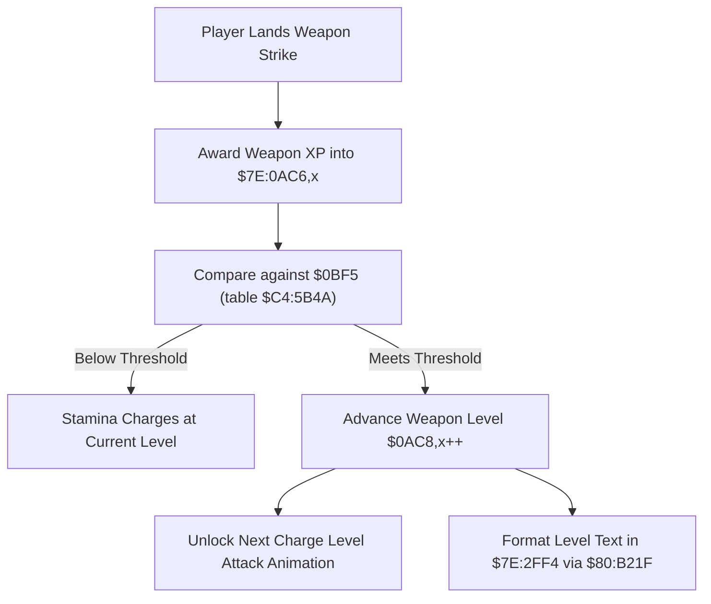

# Weapon Skill Level Requirements & Progression Tables

- **ROM Locations**:
  - `weapon_skill_threshold_lookup`: `$8E:AC9B` – `$8E:ACE0`
  - `weapon_skill_level_table`: `$C4:5B4A` – `$C4:5B69`
- **CPU State**: 16-bit A/X (`REP #$30`), Data Bank `$8E` / `$7E`
- **WRAM Core Addresses**:
  - `$7E:0BF5`: Current weapon level XP threshold target.
  - `$7E:0AC6,x`: Active weapon skill experience points.
  - `$7E:0AC8,x`: Active weapon skill level (0..3).
  - `$7E:2FF4`: Formatted menu text string buffer.

---

## 1. Architectural Architecture & Progression Curve

Weapon mastery in Secret of Evermore scales across levels 0 through 3 (with extended tiers up to Level 9 for Bazooka ammo). Each attack level unlock requires surpassing cumulative experience thresholds stored in Bank `$C4`.

### Master Threshold Table (`$C4:5B4A`)
The 16-bit table at `$C4:5B4A` defines the base experience points required to advance weapon mastery:

| Level Tier | Required XP | Accumulated Milestone | Unlocked Attack Property |
|---|---|---|---|
| **Level 0** | `0` | 0 XP | Standard quick attack jab (under 100% stamina) |
| **Level 1** | `30` | 30 XP | Full 100% standard weapon strike |
| **Level 2** | `50` | 80 XP | Charge Level 2 strike / projectile wave |
| **Level 3** | `70` | 150 XP | Charge Level 3 master attack |
| **Tier 4** | `100` | 250 XP | High-tier Bazooka shell burst |
| **Tier 5** | `120` | 370 XP | Heavy Bazooka shell burst |
| **Tier 6** | `140` | 510 XP | Particle Bazooka shell burst |

---

## 2. Disassembly & Annotations

> **Interactive 65816 Assembly**:
> Centralized comments infused at runtime.
> [View in VFS: soe://rom/code/8EAC9B](soe://rom/code/8EAC9B?asm=1&c=0)

---

## 3. Reconstructed Clean C Implementation

> **Reconstructed C Decompilation**:
> Source moved to [`reconstructed-c/8E/8EAC9B_weapon_level_tables.c`](../../../reconstructed-c/8E/8EAC9B_weapon_level_tables.c).
> [View in VFS: soe://rom/code/8EAC9B](soe://rom/code/8EAC9B?c=1&asm=0)

