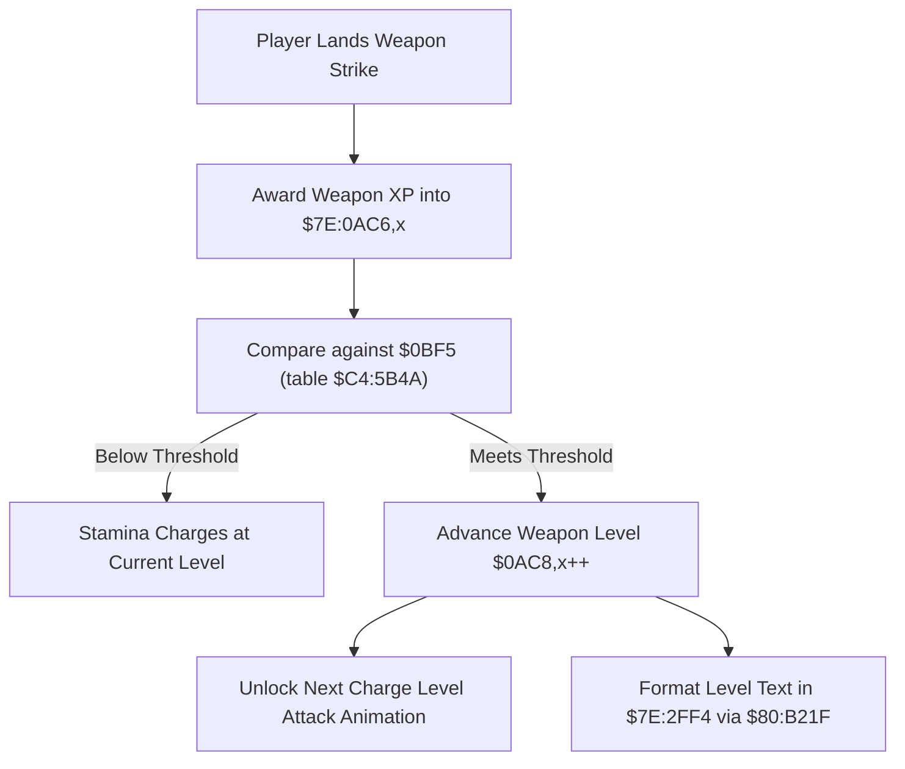

# Weapon Skill Level Requirements & Progression Tables

- **ROM Locations**:
  - `weapon_skill_threshold_lookup`: `$8E:AC9B` – `$8E:ACE0`
  - `weapon_skill_level_table`: `$C4:5B4A` – `$C4:5B69`
- **CPU State**: 16-bit A/X (`REP #$30`), Data Bank `$8E` / `$7E`
- **WRAM Core Addresses**:
  - `$7E:0BF5`: Current weapon level XP threshold target.
  - `$7E:0AC6,x`: Active weapon skill experience points.
  - `$7E:0AC8,x`: Active weapon skill level (0..3).
  - `$7E:2FF4`: Formatted menu text string buffer.

---

## 1. Architectural Architecture & Progression Curve

Weapon mastery in Secret of Evermore scales across levels 0 through 3 (with extended tiers up to Level 9 for Bazooka ammo). Each attack level unlock requires surpassing cumulative experience thresholds stored in Bank `$C4`.



### Master Threshold Table (`$C4:5B4A`)
The 16-bit table at `$C4:5B4A` defines the base experience points required to advance weapon mastery:

| Level Tier | Required XP | Accumulated Milestone | Unlocked Attack Property |
|---|---|---|---|
| **Level 0** | `0` | 0 XP | Standard quick attack jab (under 100% stamina) |
| **Level 1** | `30` | 30 XP | Full 100% standard weapon strike |
| **Level 2** | `50` | 80 XP | Charge Level 2 strike / projectile wave |
| **Level 3** | `70` | 150 XP | Charge Level 3 master attack |
| **Tier 4** | `100` | 250 XP | High-tier Bazooka shell burst |
| **Tier 5** | `120` | 370 XP | Heavy Bazooka shell burst |
| **Tier 6** | `140` | 510 XP | Particle Bazooka shell burst |

---

## 2. Disassembly & Annotations

```assembly
; ==============================================================================
; weapon_skill_threshold_lookup ($8E:AC9B)
; ==============================================================================
$8EAC96  C2 20       REP #$20          ; 16-bit Accumulator
$8EAC98  A5 12       LDA $12           ; Weapon category index
$8EAC9A  AA          TAX
$8EAC9B  BF 4A 5B C4 LDA $C45B4A,X     ; Load required XP threshold from $C4:5B4A
$8EAC9F  8D F5 0B    STA $0BF5         ; Store target threshold
$8EACA2  85 02       STA $02
$8EACA4  64 04       STZ $04
$8EACA6  A9 F4 2F    LDA #$2FF4        ; Text buffer address
$8EACA9  85 22       STA $22
$8EACAB  A9 7E 00    LDA #$007E        ; Bank $7E
$8EACAE  85 24       STA $24
$8EACB0  22 1F B2 80 JSL $80B21F       ; Format number string
$8EACB4  A0 4D 03    LDY #$034D         ; Text box descriptor
$8EACB7  22 03 9E 8C JSL $8C9E03       ; Render level threshold to status window
$8EACBB  6B          RTL
```

---

## 3. Reconstructed Clean C Implementation

```c
#include <stdint.h>
#include <stdbool.h>

#define MAX_WEAPON_TIERS 16

// Master skill threshold requirements table ($C4:5B4A)
extern const uint16_t g_weapon_xp_thresholds[MAX_WEAPON_TIERS]; // [0, 30, 50, 70, 100, 120, 140, ...]

typedef struct {
    uint16_t current_xp;       // $7E:0AC6,x
    uint16_t current_level;    // $7E:0AC8,x
    uint16_t target_threshold; // $7E:0BF5
} WeaponMasteryState;

extern WeaponMasteryState g_weapon_mastery[4]; // Swords, Axes, Spears, Bazookas

extern void format_number_string(uint16_t value, char *out_buf);
extern void render_status_text(const char *text);

/**
 * Looks up the required experience threshold for the weapon category,
 * stores it to $0BF5, and formats the numeric text for the status menu.
 * Corresponds to $8E:AC9B.
 */
void weapon_skill_threshold_lookup(uint8_t category_idx, char *text_buffer) {
    if (category_idx >= 4) category_idx = 0;

    WeaponMasteryState *mastery = &g_weapon_mastery[category_idx];
    uint16_t level = mastery->current_level;
    if (level >= MAX_WEAPON_TIERS) level = MAX_WEAPON_TIERS - 1;

    // Load required XP milestone from $C4:5B4A
    uint16_t threshold = g_weapon_xp_thresholds[level];
    mastery->target_threshold = threshold;

    // Format string into WRAM buffer $7E:2FF4 and render to status screen
    format_number_string(threshold, text_buffer);
    render_status_text(text_buffer);
}
```
