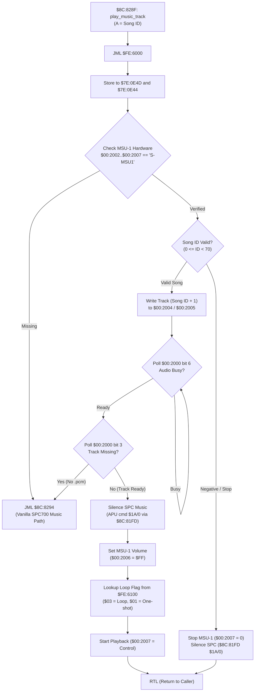

# Secret of Evermore MSU-1 Streaming Audio Architecture

> Domain: Audio Subsystem, SNES Co-processor Expansion, ROM Patching  
> Output ROM: `out/soe-msu1.sfc` (4.0 MB FastROM HiROM)  
> Asar Source: `tools/msu1/msu1.asm`  
> Patch Tool: `tools/msu1/convert.mts`  
> Test Suite: `tests/msu1/msu1.test.mts`  
> Related Docs: [The "For Dummies" Guide](for-dummies.md) · [Hardware Registers Specification](hardware-registers.md) · [ARAM Memory Analysis](aram-analysis.md)  

---

## 1. Executive Summary & MSU-1 Overview

The **MSU-1 (Media Streaming Unit revision 1)** is an open pseudo-coprocessor specification created by Near (byuu) that functions as an expansion CD-ROM interface for the Super Nintendo Entertainment System. It maps hardware control registers directly into the SNES CPU memory space at addresses `$00:2000`–`$00:2007`, enabling up to 4 GB of streaming data and 44.1 kHz 16-bit stereo CD-quality audio playback (`.pcm` tracks) mixed directly on hardware (SD2SNES / FXPak Pro) or in modern emulators (bsnes, higan, Mesen).

In vanilla *Secret of Evermore*, background music is handled by the **Wolfgang v3** SPC700 driver executing in the 64 KB ARAM of the Sony SPC700 audio processor. Because music samples and sequence bytecodes consume ~24 KB of ARAM, the vanilla engine dynamically uploads Bit Rate Reduction (BRR) instrument sample blocks across CPU/APU communication ports (`$2140`–`$2143`) via the SPC700 IPL bootloader whenever changing environments or switching music.

By enhancing *Secret of Evermore* with MSU-1 audio streaming:
1. **Uncompressed Studio-Quality Audio:** The game streams full 44.1 kHz 16-bit CD stereo audio with hardware-timed looping.
2. **Instant Music Transitions:** Background tracks begin streaming within frames, bypassing expensive synchronous SPC700 IPL bootloader sample transfers.
3. **Preservation of Sound Effects:** The SPC700 sound driver continues to run uninterrupted for all in-game sound effects (weapon swings, alchemy spells, dog barking, monster cries, and ambient impacts).
4. **Zero-Degradation Fallback:** The patch includes active runtime hardware detection and track validation: if MSU-1 hardware is absent or a track `.pcm` file is missing, the engine gracefully executes the vanilla SPC700 music driver.

---

## 2. Comparative Analysis: Vanilla Wolfgang v3 vs. MSU-1

| Metric / Dimension | Vanilla Wolfgang v3 Sound Engine | MSU-1 Audio Enhancement |
|---|---|---|
| **Audio Format** | 4-bit ADPCM (BRR - Bit Rate Reduction) | 16-bit Signed Linear PCM, 2-Channel Stereo |
| **Sample Rate** | 32,000 Hz (DSP native hardware rate) | 44,100 Hz (Full Red Book CD audio standard) |
| **Memory Budget** | Confined to 64 KB SPC700 ARAM (shared with driver, echo buffer, and SFX) | Up to 4 GB external streaming memory (zero ARAM usage) |
| **Track Switching Cost** | Dynamic IPL block upload via `$8C:805B` with interrupts disabled (`$4200=0`) causing visible stalls (1–3 seconds) | Asynchronous register write to `$00:2004`–`$00:2005` (playback starts within 1–2 frames) |
| **SPC700 ARAM Headroom** | Music samples occupy ~23,616 B; only 62 base SFX fit permanently in ARAM | 23,616 B of ARAM freed; all 71 sound effects fit into ARAM simultaneously without bank swaps |
| **Composition Complexity** | Requires reverse-engineering Wolfgang bytecode opcodes (`$F2`, `$F3`, `$F5`, `$F6`) and building instrument BRR banks | Standard WAV / PCM audio mastering with loop sample markers in the file header |
| **Hardware Compatibility** | Runs on stock SNES cartridge hardware | Requires MSU-1 capable environment (FXPak Pro / SD2SNES cartridge, Mesen, bsnes, snes9x) |

---

## 3. Engine Patch Architecture & Control Flow

### 3.1 Hook Point: `play_music_track` (`$8C:828F`)
In *Secret of Evermore*, all background music playback—whether triggered by script opcode `0x33` (`$8C:D6D6`), room transitions, cutscenes, or game over sequences—funnels into the top-level music dispatcher `play_music_track` at `$8C:828F`.

The vanilla entry point begins with 5 bytes:
```assembly
$8C:828F  C2 30       REP #$30          ; 16-bit Accumulator and Index registers
$8C:8291  8D 4D 0E    STA $0E4D         ; Store active song ID into WRAM $7E:0E4D
```

The MSU-1 patch replaces these 5 bytes with an inter-bank jump to extended ROM space:
```assembly
$8C:828F  5C 00 60 FE JML $FE6000       ; Jump Long to MSU-1 Dispatcher
$8C:8293  EA          NOP               ; Single-byte padding
```

### 3.2 Dispatcher & Hardware Detection Kernel (`$FE:6000`)
The patch kernel resides in Bank `$FE` (`$FE:6000` / file offset `0x3E6000`), utilizing the standard 4th-megabyte expansion space established by Everscript engine tooling.



### 3.3 Register Map & Protocol Implementation

| Address | Mode | Purpose in Evermore MSU-1 Kernel |
|---|---|---|
| `$00:2000` | Read | **Status Register:** Checked for Bit 6 (`0x40`, audio busy) and Bit 3 (`0x08`, track missing). |
| `$00:2002`–`$00:2007` | Read | **Hardware Identification:** Checked against ASCII `"S-MSU1"` (`$2D53`, `$534D`, `$3155`) in 16-bit words. |
| `$00:2004`–`$00:2005` | Write | **Audio Track Number:** 16-bit 1-based index (`Song ID + 1`). Writing high byte `$00:2005` initiates track seek. |
| `$00:2006` | Write | **Audio Volume:** Set to `$FF` (100% full volume) at track start. Can be modulated by volume fade hooks. |
| `$00:2007` | Write | **Audio Control:** `$03` starts looped playback (Bit 0 Play, Bit 1 Repeat). `$01` starts one-shot playback. `$00` stops playback. |

### 3.4 Fallback Execution Invariant
If MSU-1 hardware is absent or the requested `.pcm` file does not exist on disk, the kernel immediately jumps to `$8C:8294`:
```assembly
$8C:8294  A9 1C 00    LDA #$001C
$8C:8297  A0 80 80    LDY #$8080
$8C:829A  22 FD 81 8C JSL $8C81FD       ; apu_command_handshake
...
```
Because `REP #$30` and `STA $0E4D` were already executed by the dispatcher, jumping directly to `$8C:8294` resumes vanilla driver execution with zero side-effects.

---

## 4. Track Manifest & Looping Rules

Evermore defines 70 internal background music tracks (`$00` through `$45`). MSU-1 track files are 1-based (`track-1.pcm` to `track-70.pcm`). The loop table at `$FE:6100` configures whether each track loops continuously (`$03`) or plays once as a stinger/fanfare (`$01`):

| Song ID | MSU-1 File | Track Title | Playback Mode | Loop Point Context |
|---|---|---|---|---|
| `0x00` | `track-1.pcm` | Main Title | Seamless Loop (`$03`) | Title sequence & opening montage |
| `0x01` | `track-2.pcm` | Battle with Thraxx | Seamless Loop (`$03`) | Boss battle theme |
| `0x02` | `track-3.pcm` | In the Arena | Seamless Loop (`$03`) | Collosia gladiator arena |
| `0x03` | `track-4.pcm` | Escape from Evermore | Seamless Loop (`$03`) | Spaceship escape sequence |
| `0x04` | `track-5.pcm` | Return to Podunk | Seamless Loop (`$03`) | Epilogue town theme |
| `0x05` | `track-6.pcm` | Village on the Plateau | Seamless Loop (`$03`) | Prehistoria village theme |
| `0x06` | `track-7.pcm` | Within the Volcano | Seamless Loop (`$03`) | Fire Eyes volcano labyrinth |
| `0x07` | `track-8.pcm` | Swamplands | Seamless Loop (`$03`) | Mud/swamp exterior |
| `0x08` | `track-9.pcm` | Southern Jungle | Seamless Loop (`$03`) | Dense prehistoric foliage |
| `0x09` | `track-10.pcm` | Bugmuck Tar Pits | Seamless Loop (`$03`) | Tar pit tunnels |
| `0x0A` | `track-11.pcm` | Desert of Doom | Seamless Loop (`$03`) | Nobilia desert crossing |
| `0x0B` | `track-12.pcm` | Queen Bluegarden | Seamless Loop (`$03`) | Ivor Tower royal chamber |
| `0x0C` | `track-13.pcm` | High in the Sky | Seamless Loop (`$03`) | Windwalker flight |
| `0x0D` | `track-14.pcm` | Control Room | Seamless Loop (`$03`) | Omnitopia reactor & core |
| `0x0E` | `track-15.pcm` | Hall of Collosia | Seamless Loop (`$03`) | Antiqua palace ruins |
| `0x0F` | `track-16.pcm` | Horace Highwater | Seamless Loop (`$03`) | Camp theme |
| `0x10` | `track-17.pcm` | Major Enemy | Seamless Loop (`$03`) | Mini-boss encounters |
| `0x11` | `track-18.pcm` | Merchant in the Cave | Seamless Loop (`$03`) | Subterranean shops |
| `0x12` | `track-19.pcm` | Elephant Graveyard | Seamless Loop (`$03`) | Bone passage |
| `0x13` | `track-20.pcm` | Pirates of Crustacia | Seamless Loop (`$03`) | Pirate ship & harbor |
| `0x14` | `track-21.pcm` | Lively Nobilia Marketplace | Seamless Loop (`$03`) | Trading square |
| `0x15` | `track-22.pcm` | Menu | Seamless Loop (`$03`) | Ring menu & inventory |
| `0x16` | `track-23.pcm` | Machinery | Seamless Loop (`$03`) | Omnitopia mechanical sectors |
| `0x17` | `track-24.pcm` | Game Over | **One-Shot** (`$01`) | Plays once upon party wipe |
| `0x18` | `track-25.pcm` | Raptor Attack! | Seamless Loop (`$03`) | Raptor ambush |
| `0x19` | `track-26.pcm` | Victory Fanfare | **One-Shot** (`$01`) | Boss defeat celebration |
| `0x1A` | `track-27.pcm` | Good Night | **One-Shot** (`$01`) | Inn rest jingle |
| `0x1B` | `track-28.pcm` | The Seashore | Seamless Loop (`$03`) | Coastline ambient theme |
| `0x1C` | `track-29.pcm` | Many Years Ago... | Seamless Loop (`$03`) | Podunk 1965 intro narration |
| `0x1D` | `track-30.pcm` | The Professor's Room | Seamless Loop (`$03`) | Abandoned laboratory |
| `0x1E` | `track-31.pcm` | Quiet Plaza | Seamless Loop (`$03`) | Podunk deserted streets |
| `0x1F` | `track-32.pcm` | Omnitopia Surface | Seamless Loop (`$03`) | Exterior space station hull |
| `0x20` | `track-33.pcm` | Storekeepers | Seamless Loop (`$03`) | Standard shopkeeper dialogue |
| `0x21` | `track-34.pcm` | Great Pyramid | Seamless Loop (`$03`) | Antiqua pyramid interior |
| `0x22` | `track-35.pcm` | Underground Path | Seamless Loop (`$03`) | Collosia catacombs |
| `0x23` | `track-36.pcm` | Hidden River | Seamless Loop (`$03`) | Antiqua underground waterway |
| `0x24` | `track-37.pcm` | Staff Roll | **One-Shot** (`$01`) | Ending credits |
| `0x25` | `track-38.pcm` | A Boy and His Dog | Seamless Loop (`$03`) | Boy and Dog theme |
| `0x26` | `track-39.pcm` | Engine Rumble | Seamless Loop (`$03`) | Mechanical ambient rumble |
| `0x27` | `track-40.pcm` | Empty / Unused | **One-Shot** (`$01`) | Placeholder slot |
| `0x28` | `track-41.pcm` | Unused 0x28 | **One-Shot** (`$01`) | Placeholder slot |
| `0x29` | `track-42.pcm` | Palace Fountains | Seamless Loop (`$03`) | Nobilia palace gardens |
| `0x2A` | `track-43.pcm` | Fire Eyes | Seamless Loop (`$03`) | Fire Eyes village theme |
| `0x2B` | `track-44.pcm` | Puppet Show | Seamless Loop (`$03`) | Gothica theater puppet sequence |
| `0x2C` | `track-45.pcm` | Minor Minion | Seamless Loop (`$03`) | Common enemy battle theme |
| `0x2D` | `track-46.pcm` | Distant Wind | Seamless Loop (`$03`) | Wind ambient theme |
| `0x2E` | `track-47.pcm` | Death of a Minotaur | Seamless Loop (`$03`) | Minotaur boss room |
| `0x2F` | `track-48.pcm` | Fields of Gothica | Seamless Loop (`$03`) | Gothica countryside |
| `0x30` | `track-49.pcm` | City of Ebony | Seamless Loop (`$03`) | Dark city of Ivor Tower |
| `0x31` | `track-50.pcm` | Over the Waterfall | Seamless Loop (`$03`) | Aquagoth river and falls |
| `0x32` | `track-51.pcm` | Darkness of the Temple | Seamless Loop (`$03`) | Temple of Collosia |
| `0x33` | `track-52.pcm` | Dark Forest | Seamless Loop (`$03`) | Gothica maze forest |
| `0x34` | `track-53.pcm` | City of Ivory | Seamless Loop (`$03`) | Upper Ivor Tower settlement |
| `0x35` | `track-54.pcm` | Omnitopia Hallways | Seamless Loop (`$03`) | Space station corridors |
| `0x36` | `track-55.pcm` | Quicksand Fields | Seamless Loop (`$03`) | Antiqua desert sand pits |
| `0x37` | `track-56.pcm` | Tinker Tinderbox | Seamless Loop (`$03`) | Tinker's workshop |
| `0x38` | `track-57.pcm` | Deserted Castle | Seamless Loop (`$03`) | Gothica castle courtyard |
| `0x39` | `track-58.pcm` | Dank Dungeon | Seamless Loop (`$03`) | Gothica prison dungeon |
| `0x3A` | `track-59.pcm` | Regal Castle | Seamless Loop (`$03`) | Royal palace interior |
| `0x3B` | `track-60.pcm` | Freak Show!!! | Seamless Loop (`$03`) | Exhibition tent theme |
| `0x3C` | `track-61.pcm` | Item Fanfare | **One-Shot** (`$01`) | Major item discovery jingle |
| `0x3D` | `track-62.pcm` | Northern Jungle | Seamless Loop (`$03`) | Upper jungle plateau |
| `0x3E` | `track-63.pcm` | Lonely Halls | Seamless Loop (`$03`) | Collosia ancient corridors |
| `0x3F` | `track-64.pcm` | Dark Greenhouse | Seamless Loop (`$03`) | Omnitopia botanical sector |
| `0x40` | `track-65.pcm` | Vigor the Indestructible! | Seamless Loop (`$03`) | Vigor boss encounter |
| `0x41` | `track-66.pcm` | Racing Pigs! | Seamless Loop (`$03`) | Gothica pig race event |
| `0x42` | `track-67.pcm` | Collapse of Ivor Tower | Seamless Loop (`$03`) | Tower collapse sequence |
| `0x43` | `track-68.pcm` | Volcano Pipes | Seamless Loop (`$03`) | Subterranean lava pipes |
| `0x44` | `track-69.pcm` | Final Battle ~ Carltron | Seamless Loop (`$03`) | Final boss encounter |
| `0x45` | `track-70.pcm` | Intruder Alarm | Seamless Loop (`$03`) | Omnitopia red-alert alarm |

---

## 5. PCM File Format & Loop Point Calculation

MSU-1 audio files follow the standard 8-byte container specification:

```
+-------------------+-----------------------------------+------------------------------------+
| Bytes 0..3 (4 B)  | Bytes 4..7 (4 B)                  | Bytes 8..N                         |
| "MSU1" (ASCII)    | 32-bit unsigned uint32_le         | Raw 44,100 Hz 16-bit Stereo Signed |
| (0x4D 0x53 0x55 31)| Loop frame sample index           | Little-Endian PCM audio data       |
+-------------------+-----------------------------------+------------------------------------+
```

- **Loop Point Byte Offset in File:**  
  $$\text{Byte Offset} = 8 + (\text{Loop Sample Index} \times 4)$$
  *(4 bytes per stereo frame: 2 channels $\times$ 2 bytes per sample)*
- **Non-looping tracks:** Bytes 4..7 are set to `0x00000000`.

---

## 6. How to Build and Run

### 6.1 Building the Enhanced ROM via TypeScript Toolchain
Run the automated builder against your clean US Evermore ROM:
```bash
node tools/msu1/convert.mts "Secret of Evermore (U) [!].smc" out/soe-msu1.sfc
```
The tool automatically:
- Strips 512-byte copier headers if present.
- Expands the ROM image from 3.0 MB to 4.0 MB FastROM HiROM.
- Injects the hook `JML $FE6000` at `$8C:828F`.
- Assembles the detection, streaming, and fallback kernel at `$FE:6000`.
- Installs the 70-byte track looping table at `$FE:6100`.
- Updates the SNES header ROM size byte (`$00:FFD7 = $0C`).
- Recalculates and updates the SNES checksum and complement.

### 6.2 Assembling via Asar
If you prefer building directly with the Asar assembler:
```bash
asar tools/msu1/msu1.asm "out/soe-msu1.sfc"
```

### 6.3 Preparing Audio Tracks
To package a 44.1 kHz 16-bit WAV file into an MSU-1 track with a specified loop point:
```bash
node tools/msu1/render-pcm.mts input_track.wav out/track-1.pcm 176400
```
*(Example: 176,400 samples = loop point at exactly 4.0 seconds into the song).*

### 6.4 Playing in Emulators or Flash Carts
1. Rename the ROM and `.pcm` files to match the same base prefix:
   - `Secret_of_Evermore.sfc`
   - `Secret_of_Evermore.msu` (empty 0-byte file indicating MSU-1 presence)
   - `Secret_of_Evermore-1.pcm`
   - `Secret_of_Evermore-2.pcm`
   - ...
2. Load the ROM in **Mesen**, **bsnes**, or copy the folder onto an **FXPak Pro / SD2SNES** SD card.

