# Secret of Evermore Patch Analysis & Architecture

A comprehensive index and technical analysis of all known ROM patches, balance overhauls, engine bugfixes, input modifications, and developer utilities for *Secret of Evermore* (SNES).

This directory analyzes both external community patches (such as those archived in `/Users/v/Documents/evermore/public patches`) and internal engine patches developed within the Everscript and reverse-engineering toolchain.

---

## 1. Directory Structure

| Document | Focus & Scope | Key Subjects |
|---|---|---|
| [public-patches.md](public-patches.md) | **External Public Patches Catalog** | Detailed breakdown of all patches in `/Users/v/Documents/evermore/public patches`: author, purpose, modified ROM addresses, byte spans, and mechanics. |
| [gameplay-balance-patches.md](gameplay-balance-patches.md) | **Gameplay Balance & Overhaul Analysis** | Deep comparative study of Ninakoru's Balance Patch 1.1 (Normal & Hard), Master Knight DH's 25th Anniversary Patch, and Faster Magic. Mathematical analysis of subtractive defense, charge multipliers, and spell EXP. |
| [bugfixes-and-engine-fixes.md](bugfixes-and-engine-fixes.md) | **Bugfixes & Engine Quirks** | Root-cause analysis of vanilla bugs and their fixes: 5-status effects overflow bug, Assassin17's bugfix suite (Atlas retention, Bazooka ammo, Bazooka charge, Silver Sheath leak), Miracle Cure, and SPC700 sound lag. |
| [system-and-tooling-patches.md](system-and-tooling-patches.md) | **System Architecture, 2-Player & Tools** | FuSoYa 2-Player Edition architecture, XaserLE Debug Menu rebuild, mziab A/B Button Swap, Everscript runtime hooks (`hotkeys.asm`, `scale_enemies.asm`, `auto_save.asm`), and SRAM reverse engineering (SramComparer, RAMsetta Stone). |

---

## 2. High-Level Taxonomy of Evermore Patches

```mermaid
flowchart TD
    Patches["Secret of Evermore Patches"]
    
    Patches --> CoOp["Multiplayer / Input"]
    Patches --> Balance["Balance & Overhaul"]
    Patches --> Bugfixes["Bugfixes & Engine Repairs"]
    Patches --> Debug["Developer & Tooling"]

    CoOp --> P2["FuSoYa 2-Player Edition v1.02<br/>(Bank $F0 Kernel, Joypad Hook)"]
    CoOp --> ABSwap["mziab A/B Button Swap v1.00<br/>(SNES Menu Standard)"]

    Balance --> Nina["Ninakoru Balance 1.1<br/>(Standard & Hard, US & ES)"]
    Balance --> Anniv["Master Knight DH 25th Anniv<br/>(Survival balance + Hit Roll ASM)"]
    Balance --> FastMag["Faster Magic<br/>(4x-5x Spell EXP multiplier)"]

    Bugfixes --> StatusBug["5-Status Effects Fix<br/>($91B7FA slot eviction)"]
    Bugfixes --> Assassin["Assassin17 Fix Suite<br/>(Atlas, Bazooka Ammo/Charge, Silver Sheath)"]
    Bugfixes --> SoundFix["SPC700 Sound Delay Fix"]

    Debug --> DbgMenu["XaserLE Debug Menu v1.0-1.3<br/>(Ring Menu hook at $CEA3EA/$FE0000)"]
    Debug --> Hotkeys["Everscript Hotkeys & Hooks<br/>(scale_enemies, auto_save, input hooks)"]
    Debug --> SRAMTools["SRAM & Memory Tools<br/>(SramComparer, RAMsetta Stone, sram-doc)"]
```

---

## 3. The Evermore Patch Landscape

Unlike *Secret of Mana* or *Chrono Trigger*, which have dozens of diverse romhacks, *Secret of Evermore* has a smaller, highly focused set of community modifications. This was historically due to three factors:
1. **Engine Complexity:** Evermore runs on an overhauled, heavily modified American derivative of the *Secret of Mana* engine, featuring custom script bytecode, a 16-bit stamina ring, custom collision bitfields, and dedicated character AI.
2. **ROM Budget Constraints:** The vanilla game occupies an unusual 3.0 MB FastROM HiROM footprint (24 Mbits, banks `$C0..$EF`), leaving virtually zero contiguous free space in vanilla banks for new routines without expanding the ROM to 4.0 MB (`$F0..$F7`) or `$FE..$FF`.
3. **Pervasive Subtractive Defense & Math Quirks:** The combat engine calculates damage by directly subtracting Defense from Attack (`Damage = max(1, (Attack * Multiplier) - Defense)`). Because of this formula, small changes to weapon charge multipliers (e.g. Level 3 4x) or stat buffs (Atlas, Defend) cause radical, non-linear spikes in player effectiveness or enemy invulnerability.

As a result, most patches target specific, well-known design pain points:

| Pain Point in Vanilla SoE | Community Solution / Patch | Key Mechanism |
|---|---|---|
| **No 2-Player Co-op** (unlike Secret of Mana) | FuSoYa 2-Player Edition v1.02 | Hijacks VBlank joypad poll (`$C0:847A`), bypasses follower AI (`$CF:D05E`), arbitrates ring menus. |
| **Inverted Menu Buttons** (B confirm, A run) | mziab A/B Button Swap v1.00 | Swaps controller bitmask evaluation in menu code; updates graphics and save configs. |
| **Monotonous Spell Grinding** (100 casts for 1-2 levels) | Faster Magic / Ninakoru / MKDH | Accelerates EXP table at `$C4:5B9C` or flattens spell level scaling curves. |
| **Game-Breaking Buff Bugs** (Atlas save exploit, 5th buff freeze) | Assassin17 Atlas Fix / Everscript `five_status_effects_fix.asm` | Fixes wear-off routine (`$91B7FA`) to clean up evicted status rather than incoming status. |
| **Overpowered Level 3 Weapon Charge** (4x multiplier ignores defense) | Ninakoru 1.1 / MKDH 25th Anniv | Reduces L2/L3 multipliers (e.g. L2: 1.75x, L3: 2.75x) to prevent boss one-shots. |
| **Disabled Developer Debug Features** | XaserLE Debug Menu v1.0–v1.3 | Restores developer ring menu at `$CEA3EA`, adding noclip, stat maxing, and map warps. |

---

## 4. Cross-Patch Compatibility Matrix

Applying multiple IPS patches to a single ROM requires understanding the memory regions, banks, and hooks each patch touches:

| Patch | ROM Header Required? | Target ROM Size | Memory Banks Modified | Can Stack With | Incompatible / Conflicts With |
|---|---|---|---|---|---|
| **FuSoYa 2-Player (v1.02)** | **Headered** (`.smc`, +512 bytes) | Expands to **4.0 MB** | `$C0` (VBlank hook), `$CC` / `$CD` (Ring menus), `$CF` (AI), `$F0` (Kernel) | Ninakoru 1.1 (apply 2P first, then Ninakoru), AB Swap, Faster Magic | Patches overwriting `$C0:847A` or Bank `$F0` |
| **Ninakoru Balance 1.1** | Both versions provided (`_header.ips` and `_no_header.ips`) | 3.0 MB (or 4.0 MB if layered over 2P) | `$C0`, `$C4` (Spells/Weapons), `$D4` (Enemies), `$90` / `$91` (Sound, Stats) | FuSoYa 2P (explicitly supported; see MD5 check), AB Swap | MKDH 25th Anniv (direct collision on enemy/spell tables) |
| **MKDH 25th Anniversary** | **Unheadered** (Clean 3,145,728 bytes) | 3.0 MB | `$C4` (Stats, Spells), `$FB` (Hit roll via HitRollChange), `$8D` (Damage) | Faster Magic (redundant), AB Swap | Ninakoru 1.1 (competing balance philosophies and table overwrites) |
| **Faster Magic** | **Unheadered** (Offset `0x045B9C`) | 3.0 MB | `$C4:5B9C..5BA4` (9 bytes only) | FuSoYa 2P, AB Swap, Debug Menu | Balance patches that modify the same 9 bytes at `$C4:5B9C` |
| **mziab A/B Swap** | **Headered** (`.smc`) | 3.0 MB / 4.0 MB | `$C0` (Input tables), Menu UI text, Ring graphics | FuSoYa 2P, Ninakoru 1.1, MKDH 25th Anniv, Assassin17 fixes | None known (minimal 52-byte surgical footprint) |
| **XaserLE Debug Menu v1.3** | **Unheadered** | Expands to **4.0 MB** | `$CE` (Config ring hook), `$FE` (Extended debug payload) | Standalone practice ROM; stacks with AB Swap | FuSoYa 2P (both expand ROM and claim high banks `$F0`/`$FE`) |
| **Assassin17 Fix Suite** | **Headered / Unheadered** (varies) | 3.0 MB | `$8D`, `$8F`, `$90`, `$91` (Vanilla engine code) | Included in Ninakoru 1.1; compatible with AB Swap & 2P | Already merged in modern balance packs |

---

## 5. Technical Takeaways for Everscript & Engine Tooling

1. **Header Awareness in IPS:** Half of the public community patches require a 512-byte copier header (`.smc`), while the other half require an unheadered ROM (`.sfc`). In Everscript, tools like `ips2asar.py` normalize offsets by stripping copier headers and targeting native SNES 24-bit bus addresses (`$C0:0000..$FF:FFFF`).
2. **Expansion Space Standards:** 
   - FuSoYa claims Bank `$F0` (`$F0:0000..$F0:0A16`) for the 2-player kernel.
   - XaserLE claims Bank `$FE` (`$FE:0000..$FE:05FF`) for the debug menu kernel.
   - Everscript uses Bank `$FD` and `$FE` (`!ROM_EXTENSION = $FD0000`, `!ROM_HOOK = $FE5000`) for custom script hooks and hotkey routines.
3. **Preserving Processor State in Hooks:** Several early community patches suffered from subtle crashes because 65816 status flags (`P.M`, `P.X`, Direct Page `D`, Data Bank `B`) were not cleanly preserved across `JSL`/`RTL` boundaries (see [snes-asm-asar-patching](../../.agents/skills/snes-asm-asar-patching/SKILL.md)). Everscript's modern patch architecture enforces strict `PHP`/`PHB`/`PHD` wraps on all injected hooks.
