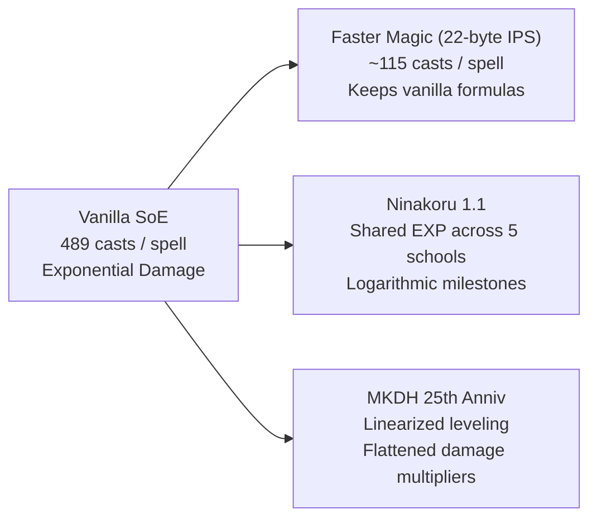

# Gameplay Balance Patches: Mathematical & Mechanical Analysis

A comparative reverse-engineering study of the balance overhauls created for *Secret of Evermore*:
- **Ninakoru's Gameplay Balance Patch 1.1** (Standard & Hard Modes)
- **Master Knight DH's 25th Anniversary Balance Patch** (including Hit Roll Recalculation)
- **Faster Magic Patch** (Community spell EXP speedup)

---

## 1. The Core Mechanical Problem: Subtractive Defense

In *Secret of Evermore*, physical damage calculations follow a strict **subtractive defense** model rather than a multiplicative or divisor-based reduction:

$$\text{Damage} = \max\left(1, (\text{Attack} \times \text{Multiplier}) - \text{Defense}\right)$$

### The Non-Linear Multiplier Explosion
Because Defense is subtracted directly from the scaled Attack value, weapon charge level multipliers create extreme non-linear spikes in damage output rather than linear progression:

| Scenario | Boy Base Attack | Enemy Defense | Level 1 Attack (1.0x) | Level 2 Attack (2.0x) | Level 3 Attack (4.0x) |
|---|---|---|---|---|---|
| **Low Defense Target** | 100 | 20 | $100 - 20 = \mathbf{80}$ | $200 - 20 = \mathbf{180}$ ($2.25\times$) | $400 - 20 = \mathbf{380}$ ($4.75\times$) |
| **High Defense Target** | 100 | 90 | $100 - 90 = \mathbf{10}$ | $200 - 90 = \mathbf{110}$ ($11\times$) | $400 - 90 = \mathbf{310}$ ($\mathbf{31\times}$!) |
| **Heavy Armored Boss** | 100 | 120 | $100 - 120 \le 0 \rightarrow \mathbf{1}$ | $200 - 120 = \mathbf{80}$ ($80\times$) | $400 - 120 = \mathbf{280}$ ($\mathbf{280\times}$!) |

In vanilla SoE:
- Level 1 attacks against late-game bosses frequently deal `1` damage (scratch damage).
- Level 3 attacks completely overcome the defense threshold, dealing hundreds or thousands of damage in a single hit.
- This creates an unhealthy combat loop: players are forced to run in circles waiting for the stamina bar to charge to 100% and then wait for Level 3 charge, while standard attacks feel completely useless.

---

## 2. Rebalancing Weapon Charge Multipliers

Both major balance patches recognize this failure and overhaul weapon charge math:

| Charge Level | Vanilla SoE | Ninakoru Balance 1.1 | Master Knight DH 25th Anniv |
|---|---|---|---|
| **Level 1** | $1.0\times$ | $1.0\times$ (+20% base weapon damage) | $1.0\times$ (hitbox extensions, frame data smoothed) |
| **Level 2** | $2.0\times$ | $\mathbf{1.75\times}$ | Smoothed frame data |
| **Level 3** | $4.0\times$ | $\mathbf{2.75\times}$ | Toned down |

By lowering Level 3 from $4.0\times$ to $2.75\times$ while simultaneously boosting base weapon power by ~20%, Ninakoru makes Level 1 attacks viable for regular crowd control while keeping Level 3 as a tactical burst rather than a boss one-shot.

---

## 3. The Magic Leveling Grind: Four Different Approaches

Alchemy spells in *Secret of Evermore* require 100 EXP points per level (Level 0 through 9). Each time a spell is cast, the game looks up an EXP increment table at `$C4:5B9C`:

$$\text{EXP Increment Table at } \$C4:5B9C = [10, 5, 4, 3, 2, 2, 1, 1, 1]$$

### Casts Required per Level in Vanilla
- Level 0 $\rightarrow$ 1: $100 / 10 = \mathbf{10}$ casts
- Level 1 $\rightarrow$ 2: $100 / 5 = \mathbf{20}$ casts
- Level 2 $\rightarrow$ 3: $100 / 4 = \mathbf{25}$ casts
- Level 3 $\rightarrow$ 4: $100 / 3 = \mathbf{34}$ casts
- Level 4 $\rightarrow$ 5: $100 / 2 = \mathbf{50}$ casts
- Level 5 $\rightarrow$ 6: $100 / 2 = \mathbf{50}$ casts
- Level 6 $\rightarrow$ 7: $100 / 1 = \mathbf{100}$ casts
- Level 7 $\rightarrow$ 8: $100 / 1 = \mathbf{100}$ casts
- Level 8 $\rightarrow$ 9: $100 / 1 = \mathbf{100}$ casts
- **Total casts to reach Level 9:** $\mathbf{489\text{ casts per spell}}$ across 30+ formulas ($>14,000$ total casts!).

### Comparison of Solutions

#### 1. Faster Magic (`Secret of Evermore Faster Magic.7z`)
- **Direct Table Multiplication:** Replaces `$C4:5B9C` with `[50, 20, 16, 12, 8, 8, 4, 4, 4]`.
- Reduces Level 9 requirements from 489 casts to **115 casts** (~4.25x speedup).
- Leaves all damage formulas, enemy health, and spell costs untouched.

#### 2. Ninakoru's Shared Spell Schools
- **Spell Clustering:** Groups all alchemy formulas into 5 thematic schools:
  1. *Physical Attack:* Hard Ball, Crush, Lance, Nitro, Corrosion, Double Drain, Drain, Explosion.
  2. *Elemental Attack:* Flash, Fireball, Acid Rain, Fire Power, Slow Burn, Lightning Storm, Sting.
  3. *Healing:* Cure, Heal, Miracle Cure, Regrowth, Revive, One Up, Super Heal.
  4. *Stat Boost:* Atlas, Defend, Barrier, Speed, Energize, Reflect, Force Field.
  5. *Utility / Misc:* Escape, Levitate, Revealer, Call Up, Stop.
- **Logarithmic Group EXP:** When a spell is cast 2, 4, 8, 16, 32, or 64 times within a level tier, it distributes bonus experience to *all other spells in that school*.
- This ensures that unlocking a late-game spell (like Nitro or Corrosion) does not start completely from scratch if the player already leveled Hard Ball or Crush.

#### 3. Master Knight DH's Linear Progression
- **Linear Damage Multipliers:** In vanilla, spell damage scaled exponentially with level. MKDH reworks the damage formula so Level 9 requires the same number of casts as Level 5, but flattens the damage multiplier curve to be linear.
- **Result:** Players never need to grind alchemy formulas to progress, while over-leveled spells can no longer trivialize boss encounters.

---

## 4. Exploits Eliminated by Balance Patches

### The "Dogcasting" Exploit
In vanilla SoE, casting an alchemy spell requires opening the Boy's ring menu. However, opening the menu pauses gameplay, and switching to the Dog allows accessing the alchemy ring while the Boy is in mid-attack, recovering from hitstun, or running. Players could unleash continuous barrage casts without weapon downtime.
- **Ninakoru's Fix:** Injects a check requiring the Boy to have **100% weapon charge** before alchemy can be cast. If below 100%, spells appear greyed out on the ring. Upon casting, weapon stamina resets to 0%. This forces tactical spacing and spell timing.

### Infinite Evasion Cheese
In vanilla SoE, the Speed buff and the Dog's agility growth can push physical Evasion to $\ge 100\%$. At 100% Evasion, all physical attacks miss automatically, rendering enemies incapable of dealing physical damage.
- **Ninakoru's Fix:** Hard-caps the Evasion attribute at **64%**. Even with max agility and active Speed buffs, enemies retain at least a 36% base chance to connect.

### Barrier Invulnerability Loop
Vanilla Barrier lasts 45 seconds and consumes 1 Limestone and 2 Wax. Limestone is cheap and infinitely purchasable from Prehistoria peddlers, allowing players to maintain continuous invulnerability throughout boss fights.
- **Ninakoru's Fix:** Drops duration from 45s to 30s; swaps Limestone requirement for **Atlas Amulet** (rare/expensive).
- **MKDH Fix:** Slashes duration from 45s to **10 seconds**, turning Barrier into a reactive parry rather than a permanent shield.

---

## 5. Boss Tuning: Thraxx & Verminator Case Studies

### Thraxx (Bug Boss)
1. **Acid Rain Might:** Thraxx casts Acid Rain, an unavoidable full-screen spell. For a first boss, its base Might (`50`) easily one-shots new players who haven't leveled their Dog or purchased water armor.
   - *MKDH:* Slashed Might from 50 to 40.
2. **Heart Bonus RNG:** When Thraxx's ribcage opens, hitting the heart applies a bonus multiplier from a hardcoded table: `{1, 2, 9, 10}`.
   - Average is 5.5, but the extreme variance meant players either dealt negligible damage (`1x`) or huge burst damage (`10x`) purely based on RNG.
   - *MKDH:* Replaced the table with `{4, 5, 6, 7}` (maintaining the 5.5 average while making combat deterministic).

### Verminator (Sewers Boss)
- In vanilla SoE, Verminator has a 5/16 probability of rolling **Explosion**. He frequently double-casts it on the Boy, dealing over 600 damage and killing the player instantly from full health without counterplay.
- *MKDH:* Reduced Explosion roll from `5/16` to `3/16`, boosting Drain and Acid Rain to `6/16`. The double-cast Explosion probability drops from $9.7\%$ to $3.5\%$.
