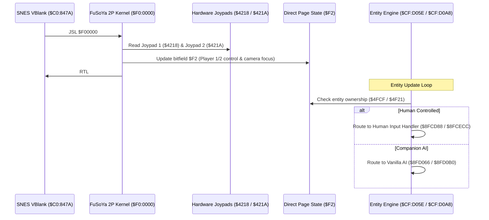

# System, Input & Tooling Patches

A technical breakdown of system-level enhancements, multiplayer engines, developer utilities, and save architecture for *Secret of Evermore*.

---

## 1. System Patches Overview

Unlike content or stat patches, system patches alter the execution core of the SNES engine:
- **Input Dispatchers & Multiplayer:** Rerouting hardware joypad registers and bypassing AI control.
- **Menu System Modifications:** Swapping control bitmasks and restoring disabled developer rings.
- **Developer Hotkeys & Hooks:** Runtime debug routines injected into extended ROM space.
- **SRAM Save Architecture:** Memory serialization, sanity checking, and comparison tools.

---

## 2. FuSoYa 2-Player Co-Op Architecture

*Full architectural disassembly and failure analysis: [docs/soe-2player-patch-analysis.md](../soe-2player-patch-analysis.md).*

### Architectural Summary
FuSoYa's patch transforms *Secret of Evermore* into a 2-player cooperative action RPG by expanding the ROM to 4.0 MB and installing a custom kernel in Bank `$F0`:



### Key Subsystem Hooks
1. **Joypad Long Jump (`$C0:847A`):**
   Replaces vanilla Joypad 1 reading with `JSL $F00000`. Reads both `$4218` and `$421A` simultaneously, storing pressed and held registers for both controllers.
2. **Master Control Bitfield (`$F2`):**
   Maintains player-character assignment:
   - Bits 0–1: Controller 1 controls Boy / Dog.
   - Bits 2–3: Controller 2 controls Boy / Dog.
   - Bits 4–5: Camera focus belongs to Boy (`$4E89`) / Dog (`$4F37`).
3. **Dynamic Drop-In / Drop-Out:**
   Pressing **START** on either controller claims an available companion or relinquishes control back to AI (`$7E4FCF` or `$7E4F21` set to `$FFFF`).
4. **Ring Menu Isolation:**
   Hooks ring menu loops in Banks `$CC` and `$CD`. Queries `$05A7` to find which entity opened the ring, reads that player's specific trigger register, and clears the consumed input with `TRB` so the second player is not interrupted.

---

## 3. mziab's A and B Button Swap (v1.00)

*Directory: `SoE_ABswap_v100/`*

### Motivation
In standard SNES convention (*Final Fantasy VI*, *Chrono Trigger*, *Super Mario RPG*), **A** confirms and **B** cancels / runs. Evermore inherited *Secret of Mana*'s inverted layout (**B** confirms, **A** runs). While exploration controls could be swapped via the in-game options menu, menu confirm actions remained hardcoded to B.

### Technical Implementation
The patch applies 27 surgical records across the ROM:
1. **Bitmask Swapping in Menu Handlers:**
   Replaces `AND #$8000` (B Button) checks with `AND #$0080` (A Button) across ring menu confirmation and shop selection routines.
2. **Save Game Config Forcing:**
   Patches save file initialization to force Control Config 2 as the default upon loading any save game.
3. **UI Sprite Swapping:**
   Modifies the VRAM tilemap pointers for prompt graphics, replacing the "B" button icon with the "A" button icon on:
   - Save confirmation prompt.
   - Action ring menu options.
   - Alchemy configuration rings.

---

## 4. XaserLE's Debug Menu Rebuild (v1.0–v1.3)

*Directory: `SoE_DebugMenu/`*

### Unlocking the Developer Debug Ring
Square USA left a complete debug ring menu inside the retail ROM but blocked player access by inserting an `RTS` at `$CEA3EA`. XaserLE's patch unblocks this and builds an extended debug suite:

```assembly
; Step 1: Neutralize the lock
ORG $CEA3EA
    NOP                  ; Allows ring menu handler to reach debug ring code

; Step 2: Intercept config ring loader
ORG $CE9A86
    JSL $FE0000          ; Jump to extended debug ring builder in Bank $FE
    NOP : NOP

; Step 3: Populate debug ring items ($FE:0000)
ORG $FE0000
    LDA #$0016 : STA $0814
    LDA #$000B : STA $0F5A ; Number of debug items
    ; Populate item command IDs into array $0F5C..$0F72:
    LDA #$0000 : STA $0F5E ; Command 0: Presets
    LDA #$0002 : STA $0F60 ; Command 1: Dog setup
    LDA #$0004 : STA $0F62 ; Command 2: Atlas boost
    LDA #$0006 : STA $0F64 ; Command 3: Walk through walls (No-Clip)
    LDA #$0008 : STA $0F66 ; Command 4: Misc
    LDA #$000A : STA $0F68 ; Command 5: Flags
    LDA #$000C : STA $0F6A ; Command 6: Spawn Enemy
    LDA #$000E : STA $0F6C ; Command 7: Unlock Items
    LDA #$0010 : STA $0F6E ; Command 8: Mode 7 Flight
    LDA #$0012 : STA $0F70 ; Command 9: Alchemy
    LDA #$0014 : STA $0F72 ; Command 10: Brian's Test Room
    RTL
```

### High-Level Debug Commands Implemented
1. **Walk Through Walls (No-Clip at `$FE:0330`):**
   Bypasses collision detection routines, allowing free traversal through walls until the ring menu is opened again. Displays an on-screen dialog: *"Clipping off until ring menu opened!"*.
2. **Full Equipment Cheat at `$FE:0400`):**
   - Sets Boy and Dog HP to 999 (`$7E0A35`, `$7E0A7F`) and current HP to 999.
   - Maxes Attack, Defense, Magic Defense, Evade, and Hit to 999.
   - Sets Level to 99 (`$7E0A50`, `$7E0A9A`).
   - Sets 99 of all 35 ingredients (`$7E22FF..$7E2322`).
   - Sets 99 bazooka shells (`$7E2345..$7E2346`).
   - Maxes all currencies to `$FFFFFF` (`$7E0AC6..$7E0AD0`).
   - Maxes all weapon levels to Level 3:99 (`$7E0ADF..$7E0AF9`).
   - Unlocks all alchemy formulas and sets levels to Level 9:99 (`$7E2F52..$7E2FD7`).
   - Grants all charms (`$7E2261`) and 99 of all trade goods (`$7E2517`).

---

## 5. Everscript Internal ASM Patches & Hooks

The sibling `everscript` engine maintains a suite of modular Asar assembly patches in `patches/*.asm`:

| Patch File | Hook Location | Purpose |
|---|---|---|
| `patches/hotkeys.asm` | `$FE:5000` (`_hook_input`) | In-game controller shortcut engine: detects Start+L, Start+R, or B combos to trigger instant memory dumps (`$28CA..$28E2`) and practice toggles. |
| `patches/scale_enemies.asm` | Entity spawn handlers | Dynamic monster scaling engine: dynamically adjusts monster HP, attack, defense, and EXP yield to match player level. |
| `patches/scale_boy.asm` | Character init | Player attribute scaling modifier. |
| `patches/auto_save.asm` | Room transition scripts | Hooks room exits to automatically serialize active game state to SRAM without visiting an inn. |
| `patches/room_timer.asm` | Frame loop | Real-time in-game room timer for speedrunning and movement analysis. |
| `patches/five_status_effects_fix.asm` | `$91:B7FA` | Clean 65816 replacement fixing the 5-status slot eviction bug. |

---

## 6. SaveRAM & Memory Tooling

*Directory: `Comparer-SoE-x64/`, `RAMsetta Stone SoE.html`, `sram-doc.txt`*

### SRAM Structure (`sram-doc.txt`)
Secret of Evermore uses 2 KB of battery-backed SRAM (`$70:0000..$70:07FF`), divided into a 2-byte header and four 512-byte save slots:
- `0x0000`: Mono / Stereo audio mode.
- `0x0001`: Last saved slot index (`0x00`, `0x02`, `0x04`, `0x06`).
- `0x0002..0x0201`: Slot 1 (512 bytes).
- `0x0202..0x0401`: Slot 2 (512 bytes).
- `0x0402..0x0601`: Slot 3 (512 bytes).
- `0x0602..0x0801`: Slot 4 (512 bytes).

### The Sanity Check Algorithm
The game prevents loading corrupted save data using a 16-bit additive checksum:
$$\text{Checksum} = \sum_{i=\text{slot} + 0x26}^{\text{slot} + 0x1FF} \text{byte}[i]$$
The calculated 16-bit sum is verified against the stored word at slot offset `+0x0024`. If mismatched, the save slot is flagged invalid and discarded.

### RAMsetta Stone (`RAMsetta Stone SoE.html`)
Created by phonymike, this reference bridges live 24-bit SNES WRAM (`$7E:0000..$7F:FFFF`) with battery save offsets:
- Boy Name: SRAM `+0x26` $\rightarrow$ WRAM `$7E:0000..$7E:0023`
- Boy Level: SRAM `+0x50` $\rightarrow$ WRAM `$7E:0A50`
- Boy Current HP: SRAM `+0x35` $\rightarrow$ WRAM `$7E:0A35`
- Active Alchemy Bitfield: SRAM `+0x158` $\rightarrow$ WRAM `$7E:2258`
- Story Flags Array: SRAM `+0x180` $\rightarrow$ WRAM `$7E:2280..$7E:237F`
This mapping forms the foundation for save editors, runtime radar displays, and SRAM comparison utilities.
