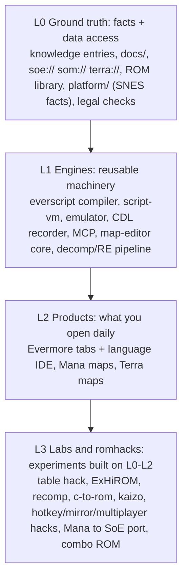

# Project map: layers, projects, juggling and AI-file scopes

Sources merged: [multi-game.md](../architecture/multi-game.md), [src/README.md](../../src/README.md), [AI_ARCHITECTURE_GUIDE.md](../../AI_ARCHITECTURE_GUIDE.md), [cleanup.md](../cleanup.md), [todo/README.md](../todo/README.md), [merge-into-everscript.md](../todo/merge-into-everscript.md), [romhacks-and-ports.md](../todo/romhacks-and-ports.md), `tools/README.md`.

> [!NOTE]
> The sibling `everscript` repo isn't readable from my sandbox. Its row is built from what these docs say about it (Python compiler, `in/` content, kaizo, patches, wiki). Please correct it.

## 1. The core idea: rank by layer first, importance second

Your concern is that a hotkey romhack and the script VM aren't peers. They aren't, so the structure should say so. Everything in the repo falls into four layers. A layer may depend only on layers above it.

- **Lower layers get stricter rules.** L0 and L1 get tests, checks and the release ritual. L3 gets a one-page charter and nothing more.
- **Every L3 item must say which L0–L2 pieces it consumes**, and may not change them silently. Needing a change means a small L1 change in its own commit.
- **Facts flow down only.** A romhack discovers an address, so it writes a knowledge entry in L0. Facts are never written only in the hack's docs.

## 2. All projects, by importance within layer

Importance reflects "what everything else breaks without". It is my judgement, so reorder it freely. Status values: 🟢 active, 🟡 maintained, ⚪ parked, 💡 idea.

| # | Project | Layer | Where | Status | Depends on | AI scope |
|---|---|---|---|---|---|---|
| 1 | **Knowledge base and VFS**: addresses, flags, tables; `soe://` `som://` `terra://`; ROM library | L0 | `localizations/knowledge/`, `src/games/*/resources/`, `src/platform/` | 🟢 | – | `game-knowledge`, `vfs-and-knowledge`, `games-and-roms`, `memory-map` |
| 2 | **Legal and quality gates**: `check:legal`, `check:knowledge`, `check:ai-context`, release ritual | L0 | `tools/check-*` | 🟡 | – | `release-ritual`, `test-discipline` |
| 3 | **Everscript language and compiler** (sibling repo `everscript`, Python; `in/` content, patches) | L1 | `../everscript` | 🟢 | 1 | the sibling repo's own files; here only a boundary contract |
| 4 | **Script VM, decoder and simulation** | L1 | `src/games/evermore/script-vm`, `script-model`, `simulation` | 🟢 | 1, 3 | `simulation`, `docs/scripts/` |
| 5 | **Language IDE** (grammar, hover, diagnostics, DAP debugger) | L2 | `games/evermore/language`, `debugger` | 🟢 | 3, 4, 6 | `grammar-rules`, `debugger-protocol` |
| 6 | **Embedded emulator + CDL recorder** | L1 | `src/core/emulator`, recorder | 🟢 | – | `emulator-subsystem`, `cdl-recorder`, `emulator-script-debugging` |
| 7 | **MCP server** (read-only window onto L0 for AI) | L1 | `src/core/mcp` | 🟡 | 1 | `vfs-and-knowledge` |
| 8 | **Map editor core** (shared shell plus per-game adapters) | L1 | `src/core/map-editor` | 🟢 | 1 | `map-editor-rules`, `feature-validation` |
| 9 | **Evermore Rooms/Map editor** | L2 | `games/evermore/rooms`, `maps` | 🟢 | 8, 1 | `map-format`, `map-construction`, `map-entities`, `rooms-tab` |
| 10 | **Evermore data tabs**: memory radar, sprites, music, scaling/alchemy, routes, ROM, data | L2 | `games/evermore/*` | 🟡 | 1, 6 | `memory-radar`, `animation-script`, `alchemy-spell-mechanics` |
| 11 | **Engine decompilation / RE pipeline** (CDL → asm → C, Ghidra, `reconstructed-c/`) | L1 | `docs/disassembly`, `reconstructed-c/`, `tools/cdl` | 🟢 | 1, 6 | `code-vfs`, `ghidra-analysis`, `re-curator` agent |
| 12 | **Table hack and ExHiROM** (move content out of the 3 MB limit) | L3→L1 | `tools/table-hack`, `tools/exhirom`, `patches/` | 🟡 | 1, 11 | `snes-asm-asar-patching`, `sample-playbacks` |
| 13 | **Custom opcodes and Kaizo opcodes** | L3 | `docs/todo/custom-opcodes.md`, sibling `in/kaizo` | 🟡 | 3, 4, 12 | `docs/scripts/opcodes.md` |
| 14 | **Static recomp** | L3 | `tools/recomp` | ⚪ | 11 | `recomp`, `recomp-debugging` |
| 15 | **C-to-ROM** and `standalone-c-rom/` | L3 | `tools/c-to-rom`, `compiler/` toolchains | ⚪ | 11 | `code-vfs` §4 |
| 16 | **Secret of Mana support** (maps, `som://`) | L2 | `src/games/mana` | 🟡 | 1, 8 | `supported-games`, `docs/mana/` |
| 17 | **Terranigma support** (rooms, `terra://`) | L2 | `src/games/terra` | 🟡 | 1, 8 | `supported-games`, `docs/terra/` |
| 18 | **Mana→Evermore bridge / SoM port** | L3 | `games/evermore/imports/mana` | 💡 | 9, 16 | `docs/mana/evermore-rooms.md` |
| 19 | **Romhack products**: hotkey, mirror mode, multiplayer, combo ROM | L3 | `docs/mirror-romhack-idea.md`, `docs/plans/multiplayer-mod.md`, `docs/exhirom/combo-rom.md` | 💡 | 12, 13 + whatever it needs | per-hack charter only |

> [!WARNING]
> `compiler/` holds third-party toolchains (Calypsi, vbcc, vasm, 816-tcc, loomcc). Check that `git ls-files compiler` tracks only your own glue and notes, not their binaries or sources. That is a legal-first item. Also, `standalone-c-rom/` has an `extract-assets` step, so confirm it only reads the user's ROM at runtime.

## 3. How to juggle it

1. **One focus per session, named in the first line of the prompt.** Use a header like `PROJECT: #12 table-hack`. The agent loads only that project's AI scope (§4). If a task needs an L0/L1 change, split it into its own commit.
2. **Cap active work.** Allow at most 2 🟢 L3 items and 1 spike at a time. Everything else is ⚪ or 💡, with a charter that says what unlocks it.
3. **Give every project a one-page charter** in `docs/projects/<name>.md`:
   - Goal and status.
   - Layer and consumed pieces.
   - Exit criterion ("done means...").
   - Next 3 steps.
   - Parking reason.

   The charter replaces the pile of `docs/*-idea.md` and `docs/todo/*` files. `docs/todo/README.md` becomes an index grouped by layer, and each row carries a `#` from the table above.
4. **Promotion and demotion rules.**
   - An L3 item that is used by two other items becomes L1. Move its code out of `tools/` and give it tests.
   - An L1 item nobody has touched or needed in about 3 months becomes ⚪ and drops out of default AI context.
5. **Shared bottleneck = L0.** Whatever you learn during a romhack (rule 0.2) lands in knowledge entries. Then side projects stay cheap, because each one starts from facts instead of re-research.
6. **Release posture.** With one user and no independent releases, treat `main` as the product. L3 work lives on short-lived branches and merges only when the L0–L2 gates are green. A *labs* folder is a later option for physically separating L3 (§5).

## 4. Fixing the AI files

The pollution comes from three habits: generic skill names that are really Evermore-only, game facts written inside skills, and one flat skill list for every layer.

**A. Three scopes, no more.**

| Scope | Where | Content | Loaded |
|---|---|---|---|
| Standing | root `AGENTS.md` | rules + the project routing table (§2 as 1 line per project) | always |
| Area | `src/**/AGENTS.md`, `tools/<x>/AGENTS.md`, `docs/projects/<x>.md` | invariants, tests, allowed deps | by location |
| Skill | `.agents/skills/` | procedure + traps for one mechanism | by trigger |

**B. Name skills by scope.** Today `map-format`, `memory-map`, `map-entities`, `simulation`, `rooms-tab`, `animation-script`, `memory-radar` and others read as universal but are Evermore-only. I suggest:
- `core-*`: game-neutral machinery (`core-map-editor`, `core-emulator`, `core-vfs`).
- `evermore-*`: Evermore-only formats and tabs.
- `mana-*` and `terra-*`: only when a game truly needs procedure beyond its docs. Usually `supported-games` plus `docs/<game>/` is enough.
- `lab-*`: romhack/L3 procedures (`lab-table-hack`, `lab-recomp`).
- Process skills (`release-ritual`, `test-discipline`, `feature-validation`) stay unprefixed.

**C. Rule: skills hold procedure, never facts.** Facts live in knowledge entries and `docs/<game>/`. A skill links to them. This is D10 ("no fact in two AI files") applied strictly, and it means a skill can't be polluted by a second game.

**D. Mana and Terra reusing the map editor.**
- The *mechanism* skill (`core-map-editor`) says only "adapter contract + shell rules".
- Each game gets a `src/games/<game>/AGENTS.md` that names its adapter, its decoder and its facts docs.
- The only cross-game file stays `imports/mana` and its table. That bridge is one explicit "mixed" area with its own AGENTS.md.
- Agent prompts then read "core-map-editor + games/mana/AGENTS.md", never the Evermore map skills.

**E. Add a routing table to the root `AGENTS.md`** (the §2 table, trimmed to project → AI scope). It replaces the long skill list, so an agent in project #12 never sees the map-editor skills. Keep the `check:ai-context` limits.

**F. The sibling `everscript` repo.** Keep the merge *deferred*. What helps now is a **boundary contract**: a generated `language-data.json` plus a versioned `source_map.json` (steps 3 of the merge doc). That ends the hand-copied signatures without merging history. If you do merge later, the gates G1–G4 in the merge doc still apply. Until then each repo owns its own skills, and the six duplicated ones need one owner each, with the other side linking.

## 5. Repo shape — recommendation

Stay a single repo for now. Splitting costs more than it saves with one user. Do these first, cheapest to most invasive:

1. Add the project table to the root `AGENTS.md` and `docs/projects/` charters (no code moves).
2. Tag `docs/todo/*` clusters with project numbers and layer.
3. Rename skills with the scope prefixes and update links (`check:ai-context` verifies the links).
4. Add `src/games/mana/AGENTS.md` and `terra/AGENTS.md` if missing.
5. Move L3 tools into `labs/` (recomp, c-to-rom, standalone-c-rom, romhack charters). This is optional, and only worthwhile if the gates should skip them.
6. Revisit the `everscript` merge after steps 1–4. Rename the repo only if it ever ships independently.

## 6. Decisions I need from you

1. Is the importance order in §2 right? In particular, where do the hotkey/mirror romhacks sit relative to Mana and Terra?
2. Prefix renames of skills (§4B): yes or no? It touches many links, but `check:ai-context` will catch breaks.
3. Do you want this committed as `docs/projects/README.md`, replacing the old structure notes? That includes the release ritual, a version bump and deploy.
