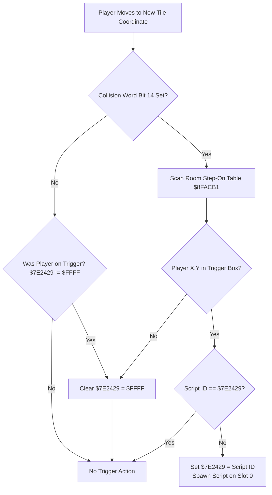
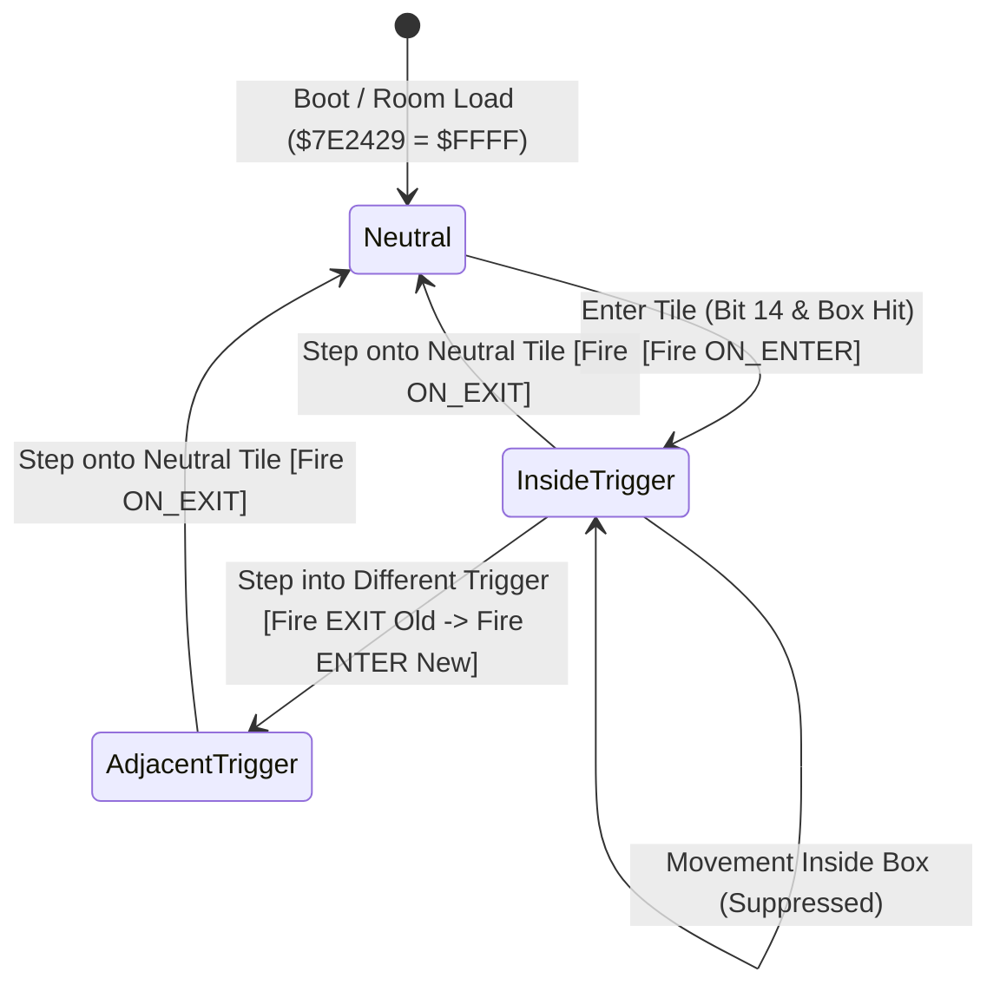

# Trigger Modernization & Exit Detection Architecture

An architectural and technical analysis of modernizing Secret of Evermore's trigger subsystem:
detecting when characters leave step-on triggers (`OnTriggerExit`), supporting the inactive
companion character (Dog), communicating trigger event context to Everscript bytecode,
supporting enemy triggers, and evaluating the CPU performance impact on the SNES 65816
versus static C recompilation (`snesrecomp`).

---

## 1. Current SoE Trigger Architecture

Secret of Evermore's room triggers are divided into two fundamental families:
1. **B-Triggers** (`bTrigger`): Evaluated when the player presses the `B` button facing an interactive tile.
2. **Step-On Triggers** (`stepOn`): Evaluated passively when a character moves onto a trigger tile.

### 1.1 The Collision Word Gate ($8FB078)
Every 16x16 metatile on a map has an associated 16-bit collision word stored in the room's collision grid:
- **Bit 15 (`$8000`)**: Interactive gate — if 1, pressing `B` while facing this tile initiates a B-trigger search (`$8FAC84`).
- **Bit 14 (`$4000`)**: Step-on gate — if 1, stepping onto this tile initiates a step-on trigger search (`$8FACB1`).

This bitmask gate is a crucial $O(1)$ fast-path optimization. The engine does **not** evaluate trigger bounding boxes on every step; it only inspects the trigger table if the destination tile has bit 14 set.



### 1.2 Table Search and Execution Loop ($8FACB1)
When the active hero moves onto a tile with bit 14 set, the engine executes `$8FACB1`:
1. It calculates the player's world tile coordinates:
   $$\text{playerTileX} = (\text{boyX} \gg 4) + \text{originX}$$
   $$\text{playerTileY} = (\text{boyY} \gg 4) + \text{originY}$$
2. It fetches the room's step-on table pointer from `$7E1061` (ROM bank in `$7E1063`) and the entry count from `$7E105F`.
3. Each record is 6 bytes:
   `[y1, x1, y2, x2, script_id_low, script_id_high]`
4. It iterates sequentially through the table:
   $$\text{hit} = (y_1 \le \text{playerTileY} < y_2 \ \land \ x_1 \le \text{playerTileX} < x_2)$$
5. **Level-Triggered Suppression**:
   - The engine reads WRAM `$7E2429` (the currently active step-on script ID).
   - If $\text{script\_id} == \$7E2429$, the trigger has already fired. The routine exits immediately without re-launching the script.
   - If $\text{script\_id} \ne \$7E2429$, it writes $\$7E2429 = \text{script\_id}$ and dispatches the script via `$8CCE5C` / `$8CCF18`.
6. **Clearing the Active Trigger**:
   - When the player steps onto a tile where bit 14 is 0 (or moves outside all bounding boxes), the engine writes `\$7E2429 = \$FFFF`.
   - **Crucially, the vanilla engine does nothing else: it simply resets the register to \$FFFF and walks away.** No script is ever executed upon leaving.

---

## 2. Detecting Player Leaving a Trigger (`OnTriggerExit`)

### 2.1 Why the Engine Currently Cannot Detect Leaving
The engine is strictly **edge-triggered on entry**:
- Entering a trigger transitions state from `$FFFF \to \text{script\_id}$` and triggers execution.
- Walking around within the trigger maintains state $\text{script\_id} \to \text{script\_id}$ (suppressed).
- Leaving the trigger transitions state $\text{script\_id} \to \$FFFF$, but there is **no invocation vector attached to this transition**.

### 2.2 Step-by-Step Implementation of `OnTriggerExit`

To add trigger exit detection to the engine (either via Asar 65816 patch or in the static C recompilation), the trigger evaluation lifecycle must be structured as a finite state machine:



#### Step 1: Hook the Transition Points in `$8FB078`
Whenever the engine checks collision and trigger status:
```text
State Variable: PREV_TRIGGER = $7E2429
Scan triggers for current tile:
  If HIT(new_trigger):
    CURR_TRIGGER = new_trigger
  Else:
    CURR_TRIGGER = $FFFF

If PREV_TRIGGER != CURR_TRIGGER:
  // State Transition Detected!
  If PREV_TRIGGER != $FFFF:
    DISPATCH_TRIGGER(PREV_TRIGGER, EVENT_EXIT)
  If CURR_TRIGGER != $FFFF:
    DISPATCH_TRIGGER(CURR_TRIGGER, EVENT_ENTER)
  $7E2429 = CURR_TRIGGER
```

#### Step 2: Handling the Adjacent Trigger Edge Case
If the player steps directly from Trigger #0 into Trigger #1 without stepping onto neutral ground:
1. `PREV_TRIGGER` is Trigger #0; `CURR_TRIGGER` is Trigger #1.
2. The engine must first fire `EVENT_EXIT` for Trigger #0.
3. The engine must immediately fire `EVENT_ENTER` for Trigger #1.
4. **Script Slot Caution**: If both scripts allocate script slot 0, firing Exit followed immediately by Enter in the same frame will either overwrite slot 0 or fail if slot 0 is marked executing (`state == 2`).
   - *Solution*: The exit script must either be executed synchronously to completion (ideal for 0-frame logic like clearing flags or opening/closing doors), or the script scheduler must allocate distinct slots (Slot 0 for Enter, Slot 1 for Exit).

#### Step 3: Map Transition / Teleport Suppression
When a step-on trigger is a teleporter or door (calling `map_transition()` or `teleport()`), the player entity is relocated to a new room.
- If the exit hook blindly executes when the room unloads, it will execute the old room's script inside the new room!
- *Rule*: Any map transition routine (`$8FD000` / room loader) must set an explicit suppress flag (or set `$7E2429 = $FFFF` *before* loading the new room) so exit scripts do not fire during room transitions.

---

## 3. Inactive Companion Character (Dog) Entering and Leaving

### 3.1 Why the Dog Currently Ignores Triggers
1. **Hero vs Companion Entity Slots**:
   - The active Boy is maintained at entity record `$7E4E89`.
   - The active Dog (or inactive companion) is maintained at entity record `$7E4F09`.
2. **Movement Routine Divergence**:
   - The Boy's movement code calls `$8FB078` and tests metatile collision bits 14 and 15.
   - The Dog's AI routine (`$90` animation VM + companion follow AI) updates position `$7E4F23 / $7E4F25` but **completely bypasses `$8FB078`**.
   - Because the companion loop never invokes `$8FACB1`, the Dog is invisible to the trigger system.

### 3.2 Companion Architecture Walkthrough
To enable companion triggers (e.g. pressure plates requiring both characters, secret dog-only scent triggers, or companion-activated floor traps):

1. **Independent State Register in WRAM**:
   - The engine *cannot* share `$7E2429`. If the Boy stands on trigger 1 (`$7E2429 = 1`) and the Dog steps on trigger 2, sharing the register would cause the Boy's trigger to re-fire on his next move.
   - Allocate `$7E242B` (or a dedicated struct) for the companion:
     - `$7E2429`: Active Hero Trigger ID
     - `$7E242B`: Companion Trigger ID
2. **Companion Movement Hook**:
   - In the companion coordinate update routine, insert a call to `check_step_on_triggers(entity_ptr = $7E4F09, state_reg = $7E242B)`.
3. **Actor Identification**:
   - Pass an entity identifier to the script dispatch so the script knows *who* stepped on or left the trigger.

---

## 4. Passing Event Context Inside the Trigger Script

When a trigger fires, how does the script know whether it was triggered by an Enter event, an Exit event, or by the Dog?

### 4.1 Using Unused $2834+ WRAM Addresses
In Secret of Evermore:
- `$7E2834` through `$7E283F` are ephemeral scratch and arithmetic words used by the script engine and room scripts.
- `$7E2834` contains general room flags.
- `$7E283E` and `$7E283F` are routinely untouched by vanilla scripts between trigger activations.

We designate `$7E283E` as the **Trigger Context Register**:

| Value | Constant | Meaning |
|---|---|---|
| `0x00` | `TRIGGER_EVENT_BOY_ENTER` | Player character entered the trigger |
| `0x01` | `TRIGGER_EVENT_BOY_EXIT` | Player character left the trigger |
| `0x02` | `TRIGGER_EVENT_DOG_ENTER` | Companion (Dog) entered the trigger |
| `0x03` | `TRIGGER_EVENT_DOG_EXIT` | Companion (Dog) left the trigger |
| `0x04` | `TRIGGER_EVENT_STAY` | Continuous frame tick while inside |

### 4.2 Everscript Authoring Syntax
In high-level Everscript, this can be exposed via compiler macros and enums:

```everscript
// Modernized Room Trigger Example
fun room_trigger_bridge_switch() {
    val event = @$283E;

    if (event == TRIGGER_EVENT_BOY_ENTER || event == TRIGGER_EVENT_DOG_ENTER) {
        // Someone stepped onto the pressure plate: extend bridge
        sound(SOUND_SWITCH_CLICK);
        set_object_state(OBJ_BRIDGE, STATE_EXTENDED);
    } else if (event == TRIGGER_EVENT_BOY_EXIT || event == TRIGGER_EVENT_DOG_EXIT) {
        // Someone stepped off: retract bridge
        sound(SOUND_SWITCH_RELEASE);
        set_object_state(OBJ_BRIDGE, STATE_RETRACTED);
    }
}
```

### 4.3 Alternative: VM Argument Block ($7E28FC + Slot * 0x30 + 0x05)
When `$8CCE5C` spawns a script, the first 6 bytes of the slot parameter block can be preloaded with arguments.
- Opcode `0x88` (`get_arg(index)`) allows a script to read parameters passed by the caller.
- The trigger dispatcher can push the event type as `arg[0]`, keeping WRAM `$7E283E` completely untouched.

---

## 5. Modernizing Triggers: Comparisons & Advanced Concepts

### 5.1 How Other Engines Handle Triggers

| Game / Engine | Trigger Model | Features |
|---|---|---|
| **Secret of Evermore (Vanilla)** | Metatile bit 14 + AABB box | Enter only; active hero only; level-suppressed by script ID |
| **Chrono Trigger** | Event collision zones & coordinate triggers | Zone-based monster encounters; enter/exit direction vectors |
| **Secret of Mana** | Metatile event masks | Enter switches; screen-edge boundary triggers; ring-menu locks |
| **The Legend of Zelda: ALttP** | Tile collision attributes & dungeon switch states | Weight switches (heavy block vs player); dual pressure switches |
| **Unreal Engine / Unity / Godot** | Volume components (AABB, OBB, Mesh) | `OnTriggerEnter`, `OnTriggerStay`, `OnTriggerExit`; collision layers & tag filters |

### 5.2 Modern Trigger Types for Evermore

1. **Directional Crossing Triggers (One-Way Gates)**:
   - Evaluates the vector of movement:
     $$\Delta X = X_{\text{current}} - X_{\text{prev}}, \quad \Delta Y = Y_{\text{current}} - Y_{\text{prev}}$$
   - Only fires if crossed in a specific direction (e.g. jumping down a ledge or passing through a one-way gate).
2. **Enemy Triggers (NPC Patrol & Trap Volumes)**:
   - When an enemy steps onto a trigger, redirect patrol paths, trigger alarms, or spring spike traps.
3. **Radial / Proximity Triggers**:
   - Replaces rectangular boxes with circular distance checks:
     $$(X - X_0)^2 + (Y - Y_0)^2 \le R^2$$
   - Useful for NPC awareness cones, sound radius, or proximity stealth.
4. **Projectile / Strike Triggers**:
   - Triggers that respond to weapons or alchemy projectiles rather than character feet (crystal switches hit by a spear or bone dart).
5. **Continuous Stay / Hazard Volumes (`OnTriggerStay`)**:
   - Ticks damage or applies status effects (poison swamp, lava floor, quicksand drag) every $N$ frames while inside the volume.

---

## 6. Performance Impact Analysis

### 6.1 SNES 65816 CPU Performance Budget
- **Clock Speed**: 2.68 MHz (standard) / 3.58 MHz (FastROM banks `$80`+).
- **Frame Budget**: Exactly **59,600 master cycles** per 60Hz NTSC video frame.
- Any routine taking more than 1,000 cycles (~1.7% of the frame) must be scrutinized.

### 6.2 Cycle Cost Comparison on 65816

| Feature | Additional Overhead per Frame | Impact on 60 FPS Budget | Feasibility on SNES |
|---|---|---|---|
| **Vanilla Step-On Check** | ~400 cycles (only if tile bit 14 set) | 0.67% | Base baseline |
| **Exit Detection (`OnTriggerExit`)** | +60 cycles (state comparison & exit dispatch) | +0.10% | **Completely negligible** (Trivial) |
| **Companion Check (Dog)** | +450 cycles (second tile & box scan) | +0.75% | **Very high performance** (Safe) |
| **Enemy Trigger Checks (All 30 Slots)** | +12,000 to +18,000 cycles (naive linear scan) | **+20% to +30%** | **Severe Slowdown / Lag** |
| **Optimized Enemy Triggers** | +800 cycles (tile bit 14 gate + spatial hash) | +1.34% | **Viable with gating** |

#### Why Naive Enemy Triggers Cause SNES Lag:
- Secret of Evermore maintains up to 30 active entity records in `$7E3DDF`.
- If 30 enemies each evaluate 10 triggers without collision gating:
  $$30 \text{ entities} \times 10 \text{ triggers} \times 40 \text{ cycles/test} = 12,000 \text{ cycles}$$
- This consumes nearly a quarter of the entire console's frame time!
- **Optimized Strategy**:
  1. Only evaluate enemies whose current tile collision word has bit 14 set ($O(1)$ rejection).
  2. Or tag specific trigger-aware enemies in their record flags (e.g. `entity + 0x10` bit 6).

### 6.3 Static C Recompilation (`snesrecomp`)
In the static recompilation port running on modern x86-64 or ARM64 hardware:
- A modern CPU executes $\approx 3 \text{ to } 5 \times 10^9$ instructions per second.
- 12,000 65816 instructions translate to approximately **1.5 microseconds** of CPU time.
- Complex enemy volume calculations, continuous `OnTriggerStay` hazard ticks, and companion exit triggers run with **essentially zero measurable overhead** (< 0.01% of a 16.6ms frame).

---

## 7. Recommended Implementation Blueprint

For modders and recomp developers implementing modernized triggers:

1. **State Storage**:
   - Hero Active Trigger: `$7E2429`
   - Companion Active Trigger: `$7E242B`
   - Event Context Scratch: `$7E283E`
2. **Transition Protocol**:
   - Detect `new_trigger != old_trigger`.
   - If `old_trigger != $FFFF`: set `@$283E = EVENT_EXIT`, dispatch `old_trigger`.
   - If `new_trigger != $FFFF`: set `@$283E = EVENT_ENTER`, dispatch `new_trigger`.
3. **Collision Gating**:
   - Maintain metatile bit 14 (`$4000`) as the prerequisite gate to preserve CPU cycles on SNES hardware.
4. **Tooling & Debugger**:
   - The VS Code emulator trace log displays entry/exit states cleanly:
     `[0x15.step[0].enter]` vs `[0x15.step[0].exit]`.
