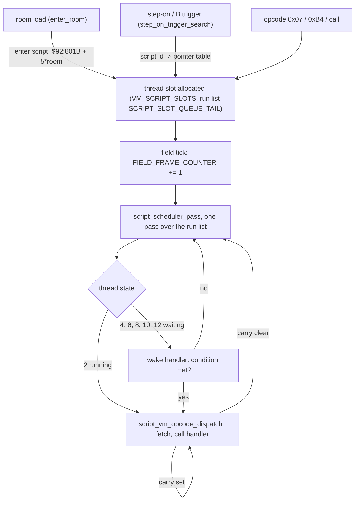

# How the script engine works

One page that ties the pieces together: what runs a script, when, with what state, and where each
piece is written down. Everything here was read from the ROM's own code (US release) or traced in the
running game; the detail pages are linked. Opcode semantics: [opcodes.md](opcodes.md). Operand and
expression formats: [vm.md](vm.md). Debugging: [debugging.md](debugging.md).

## The big picture

A script is bytecode in ROM (banks `$92`+). The engine is a cooperative multitasker: up to 20 threads,
each a script pointer plus a few fields, advanced once per field frame. A thread runs instructions
until one **yields** (sleep, wait, call, end, map change) and then waits for the next frame.

## Threads

- **Slots**: 20 slots of `$4F` bytes from `$7E:28FC` ([VM_SCRIPT_SLOTS](../../src/games/evermore/localizations/knowledge/wram/VM_SCRIPT_SLOTS.md)).
  Known fields: `+0..+2` script pointer (24 bit), `+3` state, `+5/+7` wake parameters, `+9` wait mask / flags,
  `+$0D` bound entity (`script_owner()`), `+$0F..+$4E` 32 thread-local words (arguments land here).
- **Run list**: 21 words at `$7E:2F28`, slots in run order, zero-terminated
  ([SCRIPT_SLOT_QUEUE_TAIL](../../src/games/evermore/localizations/knowledge/wram/SCRIPT_SLOT_QUEUE_TAIL.md)).
  A callee takes its caller's place in the list and runs in the same pass; a started thread is appended and
  runs later in the same pass.
- **Guard**: `$7E:1436` is set while a pass runs; the pass is skipped when it is already non-zero
  ([DISPATCH_MUTEX_LOCK](../../src/games/evermore/localizations/knowledge/wram/DISPATCH_MUTEX_LOCK.md)).
  Bit 0 of `$7E:22EE` is the master suspend gate set during dialogue and cleared on room transition
  ([SCRIPT_EXECUTION_LOCK_FLAGS](../../src/games/evermore/localizations/knowledge/wram/SCRIPT_EXECUTION_LOCK_FLAGS.md)).
- **Direct page while running**: `$7E` the slot, `$80` the run-list index, `$82..$84` the script pointer,
  `$86` the run-list end.

### Thread states

The scheduler (`$8C:CFFD`) calls `JSR ($D029,X)` with X = the slot's state; the table is
[SCRIPT_THREAD_WAKE_TABLE](../../src/games/evermore/localizations/knowledge/routines/SCRIPT_THREAD_WAKE_TABLE.md).

| state | handler | the thread waits for | started by |
|---|---|---|---|
| 0 | `$8C:E8BC` (an `STP`) | free slot | |
| 2 | [script_thread_resume](../../src/games/evermore/localizations/knowledge/routines/script_thread_resume.md) | nothing, runs | |
| 4 | [script_thread_wake_timer](../../src/games/evermore/localizations/knowledge/routines/script_thread_wake_timer.md) | `$0B19` (32 bit) to reach the deadline in `+5/+7` | `sleep` (`0x39 0x3B 0xA7 0xA8`) |
| 6 | [script_thread_wake_busy_bits](../../src/games/evermore/localizations/knowledge/routines/script_thread_wake_busy_bits.md) | an entity's busy bits | `wait(entity)` |
| 8 | [script_thread_wake_trigger_done](../../src/games/evermore/localizations/knowledge/routines/script_thread_wake_trigger_done.md) | `$2429` (active trigger script) to change | `wait(1)` |
| 10 | [script_thread_wake_bytes_match](../../src/games/evermore/localizations/knowledge/routines/script_thread_wake_bytes_match.md) | `$107E,X == $10CE,X` (record in `+5`; text box or room object, open) | `wait($0100 + n)` |
| 12 | [script_thread_wake_camera_still](../../src/games/evermore/localizations/knowledge/routines/script_thread_wake_camera_still.md) | the camera (`$BF`, `$C1`) to stop | `wait(2)` |

## One instruction

[script_vm_opcode_dispatch](../../src/games/evermore/localizations/knowledge/routines/script_vm_opcode_dispatch.md)
(`$8C:D0A6`) reads a byte through `[$82]`, advances the pointer, and calls the handler from the word table at
`$8C:E8BD`. The handler returns **carry set** (the next instruction runs at once) or **carry clear** (the turn
is over). Either way the pointer is written back to the slot, unless the high word at `$83` is 0 (the script ended).
Unused opcodes point at `STP` instructions. Handlers: [opcodes.md](opcodes.md),
`soe://rom/assets/scripts/opcodes/<xx>.md`.

## Values: expressions and variables

Operands are postfix expressions evaluated by `$8C:EA43` into a 32-bit value ([vm.md](vm.md)). They read three
variable areas:

| area | where | lifetime | written in |
|---|---|---|---|
| save flags and bytes | `$7E:2258..$7E:2833`, copied to SRAM | the save file | [unnamed-memory-audit.md](unnamed-memory-audit.md) |
| temp (compiler `TEMP`) | `$7E:2834..$7E:28FB` | cleared on room load | [TEMP_COMPILER_ARENA](../../src/games/evermore/localizations/knowledge/wram/TEMP_COMPILER_ARENA.md) |
| thread-local | slot `+$0F..` | the thread | arguments are staged at `$7E:0E80 + 2i` ([VM_SCRIPT_CALL_ARG_0](../../src/games/evermore/localizations/knowledge/wram/VM_SCRIPT_CALL_ARG_0.md)) |

The character constants of scripts come from three pointers: `boy()` = `$0F3E`
([ENTITY_PTR_BOY](../../src/games/evermore/localizations/knowledge/wram/ENTITY_PTR_BOY.md)), `dog()` = `$0F40`
([ENTITY_PTR_DOG](../../src/games/evermore/localizations/knowledge/wram/ENTITY_PTR_DOG.md)), the camera
character = `$0F42`; `last_entity()` = `$0341`
([LAST_SPAWNED_ENTITY](../../src/games/evermore/localizations/knowledge/wram/LAST_SPAWNED_ENTITY.md)).
All timing counts in [FIELD_FRAME_COUNTER](../../src/games/evermore/localizations/knowledge/wram/FIELD_FRAME_COUNTER.md).

## Where scripts start

Enter script per room (`$92:801B + 5 * room`), step-on and B triggers per room (`$9F:FDE7 + 4 * room`), global
ids through the pointer table in the bank header, and five room hooks that a script attaches with opcode `0x3F`
([ROOM_HOOK_0_SCRIPT_ID](../../src/games/evermore/localizations/knowledge/wram/ROOM_HOOK_0_SCRIPT_ID.md)..4).
Details: [vm.md](vm.md), [map_transitions.md](map_transitions.md), [arrivals.md](arrivals.md).
`CHANGE MAP` loads the next room synchronously; no thread survives it and the new enter script starts in the
same tick.

## The tags

Everything above is findable by one tag, `script-vm`, in the `tags:` of the knowledge entries:

- **RAM** (30 entries, `knowledge/wram/`): slots, run list, guard, locks, arguments, temp arena, room hooks, the
  entity pointers and the frame counter. The WRAM map's `script` tag stays the broader "scripts touch this"
  tag (story flags, pickups).
- **ROM** (about 210 entries, `knowledge/routines/`): the scheduler, state table and wake handlers, dispatcher,
  expression evaluator and its sub-op table, opcode handler table and handlers (`script_op_*`), the bank header,
  the room enter and trigger tables, the trigger search and room-enter code.
- Opcodes keep their own tags, `opcode.<group>` (`soe://tags/opcode.flow`, ...). The individual game scripts
  that have an entry (`script_abs_*`) keep `script, vm, event`: they are data run by the engine, not the engine.

List them: `grep -l "script-vm" src/games/evermore/localizations/knowledge/wram/*.md`.

## Open

- State 10's record: text box or room object (`$0FAE` is ROOM_OBJECTS_COUNT in the WRAM map, but the `0x2e`
  entry calls it a text box bound).
- The slot fields `+5/+7/+9` mean different things per state; only the table above is traced. `+$0B` is not traced.
- `SCRIPT_CALL_ARG_1..3` (`$7E:24B3..$24B7`) look like call parameters but are not tagged: unverified.
- `reconstructed-c/include/soe_ram.h` still carries the old names `WAVE_PHASE_COUNTER` / `controller_prev_input`
  (generated header; regenerate when its generator is next run).
