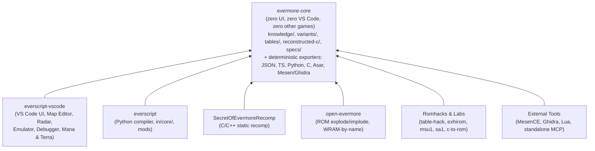

# Modular Architecture: Extracting `evermore-core`

**Status: 💡 Concept / Proposal (2026-11-22).**
Alternative to both keeping everything in the `everscript-vscode` monolith ([docs/projects/README.md](../projects/README.md) §5) and merging into an even larger `everscript` monolith ([merge-into-everscript.md](merge-into-everscript.md), deferred).

---

## 1. Why Break Up the Monolith

Today `everscript-vscode` carries four different responsibilities in one repository:

1. **The Evermore knowledge base** — ~7,100 routine entries, ~1,560 WRAM entries, ~258 opcode entries (`src/games/evermore/localizations/knowledge/`), `variants.json`, `rom-map.md` / `wram-map.md`, `rooms.json` / `scripts.json` / `types.json`, `reconstructed-c/`, and format docs (`docs/map-format/`, `docs/scripts/`, `docs/disassembly/`).
2. **Pure decoders & models** — `maps/`, `script-vm/`, `script-model/`, `simulation/`, and the `soe://` virtual file system.
3. **The VS Code extension & multi-game UI** — Map Editor, Memory Radar, Scripts/Data/Code/Sprites/Music/Routes/Scaling tabs, DAP debugger, Language IDE, embedded `snes9x` WASM emulator, MCP server, plus Secret of Mana and Terranigma support.
4. **Independent tools & romhack labs** — `tools/open-evermore/`, `tools/table-hack/`, `tools/exhirom/`, `tools/recomp/`, `tools/c-to-rom/`, `tools/msu1/`, `tools/sa1/`, `tools/combo/`.

Meanwhile, multiple projects outside this repo depend on the **same Evermore facts**:

| Consumer | Language / Runtime | What it needs from Evermore ground truth |
|---|---|---|
| `everscript-vscode` | TypeScript / VS Code | Knowledge entries, variants, tables, `reconstructed-c/`, `soe://` VFS, decoders |
| `everscript` | Python | Opcode table, WRAM symbols, ROM table addresses, `in/core/` validation |
| `SecretOfEvermoreRecomp` | C / C++ | Routine boundaries, WRAM struct/address headers, `reconstructed-c/`, enums, overlay tokens |
| `open-evermore` | TypeScript / Node | Table locations, variant layouts, WRAM symbol map, codecs |
| Romhacks & patches (`table-hack`, `exhirom`, `msu1`, `sa1`, `c-to-rom`) | Asar 65c816 ASM / C / TS | Address includes (`.inc`), table layouts, free-space maps, variant offsets |
| External emulators & RE tools | MesenCE `.mlb`, Ghidra JSON, Lua | Symbol labels, routine/ASM comments, overlay constants (`soestuff.lua`) |

Keeping the ground truth buried inside a VS Code extension repo causes three concrete problems:
- **Drift:** `everscript`, `SecretOfEvermoreRecomp`, and external scripts end up with hand-copied addresses, signatures, and maps ([merge-into-everscript.md](merge-into-everscript.md) §1).
- **Heavy coupling:** Editing a WRAM fact or running a small romhack script sits inside a repo with webviews, WASM emulator cores, VS Code packaging, and unrelated games.
- **No language-neutral contract:** Consumers in Python, C/C++, Asar ASM, and Lua have no clean, zero-UI artifact they can pin and import.

---

## 2. The Core Concept: `evermore-core`

Split the **ground truth** out of the UI and tools into a dedicated, dependency-free repository: **`evermore-core`**.

**Core invariant:** `evermore-core` has **zero dependency on VS Code, UI/webviews, emulators, the Python compiler, or other SNES games**. It holds only Evermore facts, schemas, documented `reconstructed-c/`, format specs, and deterministic exporters that project those facts into every language our projects use.



Every arrow points **down** to `evermore-core`. Nothing in `evermore-core` ever imports or knows about a downstream UI, compiler, or hack.

---

## 3. What Lives in `evermore-core` (and What Stays Out)

To keep `evermore-core` clean and prevent it from turning into a second monolith, organize it into three explicit layers:

### Layer A — Canonical Data & Specs (Source of Truth)
Pure, language-neutral data validated by JSON Schema and legal checks:

```
evermore-core/
  schemas/                 JSON Schemas for every data kind (routine, wram, opcode, variant, table, tag)
  knowledge/
    routines/              Per-routine facts (address, name, signature, bank, evidence, callers/callees)
    wram/                  Per-WRAM-address facts ($7E/$7F layout, types, lifecycle, evidence)
    opcodes/               Event-script VM opcode definitions (byte, args, semantics)
  data/
    variants.json          All 6 retail ROM hashes, regions, and per-variant table offsets
    rooms.json             Room catalog & names
    scripts.json           Script catalog & names
    tables.json            ROM master table descriptors (address, stride, count, schema)
    types.json             Shared struct/enum definitions
    tags.json              Ontology for soe://tags/
    asm-comments.json      Verified disassembly comments
    sound-animations.json  Sound/animation cross-references
    overlay-tokens.json    Canonical debug/overlay color & badge tokens (shared by UI, Recomp, Lua)
  reconstructed-c/         Documented C reconstructions of vanilla ROM routines (exact behavior)
  specs/                   Evermore format specifications (map-format, script-vm, memory-map, alchemy, audio)
  skills/                  Evermore-fact AI skills (game-knowledge, memory-map, map-format, c-style)
  tools/
    validate.mts           Fast (<2s) schema + knowledge integrity + legal-first check
    export.mts             Deterministic multi-language artifact generator
```

### Layer B — Generated Multi-Language Projections (`exports/` or release artifacts)
One `npm run export` (or CI build) generates clean, ready-to-consume bindings from Layer A so no downstream repo ever parses raw Markdown or hand-copies constants:

| Target | Generated Output | Consumers |
|---|---|---|
| **TypeScript / JS** | Typed JSON + lightweight `@evermore/core` loader (`getRoutine`, `getWram`, `resolveVariant`, `getTable`) | `everscript-vscode`, `open-evermore`, Node tools |
| **Python** | `evermore_core` package / generated `.py` constants & JSON bundle (opcodes, WRAM, tables) | `everscript` compiler, `in/core/` cross-checks |
| **C / C++** | `include/evermore/wram.h`, `tables.h`, `enums.h`, `routines.h`, `overlay_tokens.h` | `SecretOfEvermoreRecomp`, `c-to-rom`, `standalone-c-rom` |
| **Asar ASM** | `asm/wram.inc`, `asm/tables.inc`, `asm/routines.inc` | `patches/`, `table-hack`, `exhirom`, `msu1`, `sa1` |
| **Emulators / RE** | MesenCE `.mlb` labels + comments, Ghidra symbol JSON, Lua constants (`soestuff.lua`) | MesenCE, Ghidra, Lua plugins |
| **Human-readable** | Generated `rom-map.md`, `wram-map.md`, wiki pages | Docs & GitHub wiki (never hand-edited) |

### Layer C — Optional Pure TypeScript Codecs (Design Choice)
There is one major boundary question: **where do the pure, headless TypeScript codecs live?**
(`maps/` decoder/encoder, `script-vm/`, `script-model/`, `simulation/`, headless `soe://` VFS, ROM variant resolver — all zero-VS-Code today.)

- **Option 1 — Pure Knowledge Repo (Recommended to start):**
  `evermore-core` contains **only** Layer A (data, schemas, `reconstructed-c/`, specs) + Layer B (multi-language exporters). Pure TS codecs remain in `everscript-vscode` (or move later into a separate `evermore-sdk` npm package).
  - *Pros:* Tiny, fast, language-neutral, zero runtime/bundler opinions, easiest to mount as a git submodule in Python and C++ repos.
  - *Cons:* `open-evermore` and CLI tools still need the TS decoders from `everscript-vscode` (or a future `evermore-sdk`).
- **Option 2 — Knowledge + Headless TS SDK:**
  `evermore-core` includes a `packages/sdk/` workspace holding the pure TS decoders and headless `soe://` VFS (plus a tiny standalone `evermore-mcp` binary).
  - *Pros:* Any TS tool (`everscript-vscode`, `open-evermore`, CLI scripts, standalone MCP) imports one package; AI agents get `soe://` in any repo without VS Code running.
  - *Cons:* Heavier repo; mixes data commits with codec logic commits.

**Recommendation:** Start with **Option 1** (pure knowledge + exporters). Once all consumers are wired and happy, decide whether pure TS codecs belong in `evermore-core/packages/sdk` or a sibling `evermore-sdk` repo.

### What Explicitly Stays OUT of `evermore-core`
- **No VS Code APIs, webviews, CSS, or panels** → stays in `everscript-vscode`.
- **No embedded emulator or CDL recorder** → stays in `everscript-vscode` (or a shared `snes-emulator` package).
- **No other games (Secret of Mana, Terranigma)** → stays in `everscript-vscode` (each game could follow the same `*-core` pattern later if it gains multiple consumers).
- **No Everscript compiler** → stays in `everscript` (which still exports `language-data.json` for IDE hover/completion).
- **No ROM bytes, extracted graphics/text/music, screenshots, or third-party code** → the same `check:legal` gate enforces legal-first rules in `evermore-core`.
- **No romhack patches or experimental labs** → each hack consumes `evermore-core` instead of living inside it.

---

## 4. Clean Consumption Patterns (How Projects Use It)

Different ecosystems prefer different dependency mechanisms. Because `evermore-core` is small and builds deterministic exports, it can support all three cleanly:

1. **Git Submodule (Best default for C/C++, Python, Asar repos):**
   - `SecretOfEvermoreRecomp`, `everscript`, and romhack repos pin `evermore-core` at an exact commit SHA under `deps/evermore-core/` (or `vendor/evermore-core/`).
   - Works offline, needs no package registry, and `git log` records the exact knowledge revision used for any build.
2. **npm Package / Local Path (Best for TypeScript repos):**
   - `everscript-vscode` and `open-evermore` depend on `@evermore/core` via GitHub tag or local workspace link (`file:../evermore-core` during active dev) so `tsc` and `esbuild` get full TypeScript types out of the box.
3. **Versioned Release Bundles (Zero-toolchain option):**
   - Every git tag (`v0.1.0`, …) attaches pre-generated `exports/` (`json`, `c`, `py`, `asm`, `mlb`) via GitHub Actions so a consumer never has to install Node just to read C headers or `.inc` files.

### Day-to-Day "Facts Flow Down" Workflow
When you discover a new WRAM address or routine while working in `SecretOfEvermoreRecomp`, `everscript`, or a romhack:
1. Record the fact once in `evermore-core/knowledge/` (takes seconds; `npm run validate` runs in <2s).
2. Commit & push `evermore-core`.
3. Update the submodule pointer / package bump in the consuming repo (or point a local override at `../evermore-core` while iterating, then pin before merging).

### Standalone MCP for AI Agents
Today, `soe://` MCP only works when VS Code is running `everscript-vscode`. With `evermore-core`, a tiny standalone CLI (`evermore-mcp`) can serve the knowledge base (and optionally ROM-backed `soe://` reads using the shared ROM library) directly to any AI agent working in `everscript`, `SecretOfEvermoreRecomp`, or a romhack repo — no VS Code instance required.

---

## 5. Resulting Ecosystem Map

| Repository | Role | Depends On |
|---|---|---|
| **`evermore-core`** | Evermore ground truth: knowledge entries, variants, schemas, `reconstructed-c/`, format specs, multi-language exporters | Nothing (zero UI, zero VS Code) |
| **`everscript`** | Everscript language, Python compiler, `in/core/` standard library, mods (Kaizo); exports `language-data.json` | `evermore-core` |
| **`everscript-vscode`** | VS Code IDE & multi-game visual workbench (Map Editor, Radar, Emulator, Debugger, Mana, Terra) | `evermore-core`, `everscript` (`language-data.json`) |
| **`SecretOfEvermoreRecomp`** | C/C++ static recompilation & native runtime | `evermore-core` |
| **`open-evermore`** *(optional split)* | Explode/implode ROM builder & WRAM-by-name linker | `evermore-core` (+ pure TS codecs) |
| **Romhack / Lab repos** *(as needed)* | `table-hack`, `exhirom`, `msu1`, `sa1`, `combo`, `c-to-rom` | `evermore-core` |

### AI Skills Without Duplication
- **`evermore-core`** owns Evermore-fact skills (`game-knowledge`, `memory-map`, `map-format`, `alchemy-spell-mechanics`, `secret-of-evermore-engine`, `c-style`).
- **Each consumer repo** owns only its own mechanism/UI skills (`everscript-vscode`: webviews, map-editor shell, emulator, debugger; `everscript`: compiler/grammar; `SecretOfEvermoreRecomp`: recomp pipeline).
- No skill is duplicated across repos; consumer repos reference `evermore-core`'s skills directly.

---

## 6. Phased Migration Plan

Each phase leaves every existing repo green and deployable — no big-bang rewrite.

- [ ] **Phase 0 — Boundary Hygiene (inside `everscript-vscode`):**
  - Confirm `src/games/evermore/localizations/knowledge/`, `data/`, `variants.json`, and `reconstructed-c/` have zero imports from `core/`, `vscode`, or UI tabs.
  - Add JSON Schemas for routine, WRAM, opcode, and variant entries.
  - Ensure `rom-map.md` and `wram-map.md` are purely generated from `knowledge/` + `data/` (no hand-edited sections lost).
- [ ] **Phase 1 — Create `evermore-core` Repo:**
  - Extract the canonical data + `reconstructed-c/` + Evermore format specs via `git filter-repo` (preserving clean, legal-checked history).
  - Add fast validation (`check:legal`, schema validation, referential integrity) and deterministic exporters (`json`, `ts`, `py`, `c`, `asm`, `mlb`).
  - Tag `v0.1.0` with CI running validation + export diff check.
- [ ] **Phase 2 — Wire `everscript-vscode` as Consumer #1:**
  - Mount `evermore-core` (submodule or `@evermore/core` package).
  - Point `src/games/evermore/localizations/` loaders and `check:knowledge` at `evermore-core`.
  - Delete the duplicated local copies once `npm test` + `npm run test:all` + `check:knowledge` pass.
- [ ] **Phase 3 — Wire `everscript` & `SecretOfEvermoreRecomp`:**
  - Replace `everscript`'s `.github/memory-map.md`, `.github/rom-map.md`, and hand-copied opcode/table constants with `evermore-core` Python exports.
  - Point `SecretOfEvermoreRecomp` at `evermore-core`'s `reconstructed-c/` and generated C headers (`wram.h`, `tables.h`, `overlay_tokens.h`).
- [ ] **Phase 4 — Re-evaluate Pure Codecs & Labs:**
  - Decide whether pure TS codecs (`maps/`, `script-vm/`, `script-model/`, `simulation/`, headless `soe://`) move into `evermore-core/packages/sdk` or a sibling `evermore-sdk` package.
  - Decide which `tools/*` (`open-evermore`, `msu1`, `sa1`, `table-hack`, `exhirom`) graduate to their own repos consuming `evermore-core`.

---

## 7. Trade-offs & Open Decisions

### Honest Trade-offs
- **Cross-repo commits:** When a feature in `everscript-vscode` or a fix in `SecretOfEvermoreRecomp` uncovers a new WRAM address, you make two small commits (`evermore-core` first, then bump the pointer in the consumer) instead of one. Keeping `evermore-core` tiny with a <2s validation script keeps this friction low.
- **SNES platform facts (`src/platform/`):** Hardware-only facts (LoROM/HiROM mapping, 65816 CPU, SPC700, CDL format, ROM library) are shared across Evermore, Mana, and Terranigma. They do *not* belong in `evermore-core`; they stay in `everscript-vscode` (or a future `snes-platform` package if another multi-game tool needs them).
- **Parity tests:** `everscript-vscode` tests that compare against `everscript` still benefit from the `language-data.json` boundary contract ([merge-into-everscript.md](merge-into-everscript.md) §4 step 3), independent of `evermore-core`.

### Decisions Needed Before Phase 0
1. **Scope of `evermore-core`:** Start with **Option 1** (pure data + schemas + `reconstructed-c/` + multi-language exporters) or **Option 2** (also include pure headless TS codecs + `soe://` VFS)?
2. **Does `reconstructed-c/` belong in `evermore-core`?** Both `everscript-vscode` (`code-tab`, `c-to-rom`) and `SecretOfEvermoreRecomp` consume it, so `evermore-core` is the natural shared home — confirm?
3. **Consumption style:** Git submodule everywhere, or npm package for TS repos + git submodule for Python/C++/ASM repos?
4. **Labs & `open-evermore`:** Keep `tools/open-evermore` and romhack tools in `everscript-vscode` until Phase 4, or split `open-evermore` right after `evermore-core`?

